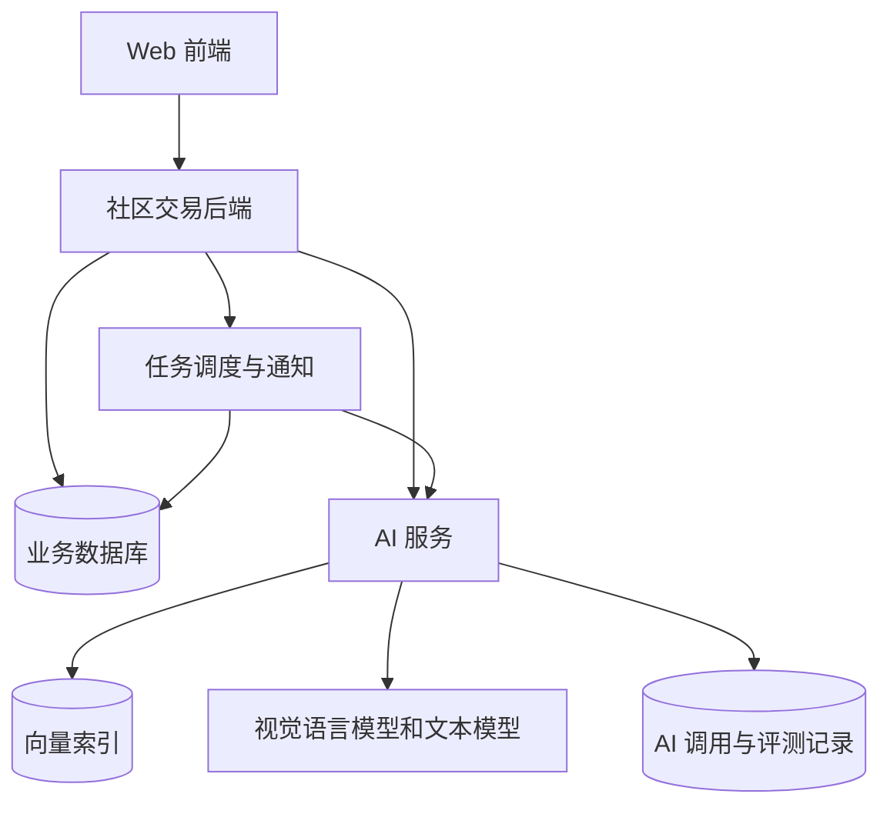
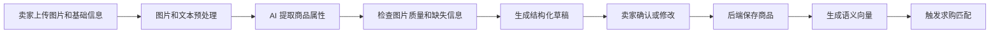
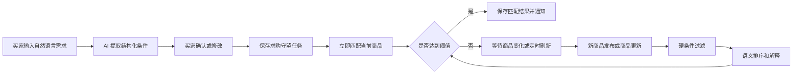
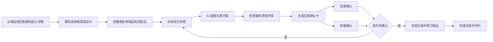

# AI 校园二手交易社区系统概要设计

## 1 文档说明

本文档说明系统边界、模块划分、数据实体、核心流程和部署关系。
产品需求及编号参见 [产品需求分析](01-产品需求分析.md)
AI 算法与指标参见 [AI 创新与评价方案](02-AI创新与评价方案.md)
项目计划参见 [项目实施与交付计划](04-项目实施与交付计划.md)
详细表结构、接口参数、类图和时序图在技术栈确定后形成后续详细设计

## 2 设计目标

- 复用现有社区后端架构，扩展校园二手交易业务。
- 将普通业务与 AI 能力解耦，模型故障不影响基础功能。
- 商品、求购、私信和交易均有清晰的数据归属和状态。
- AI 使用结构化输入输出，并保留用户确认环节。
- 支持课程环境下的开发、测试、部署和现场演示。
- 控制组件数量，优先保证完整闭环和可维护性。

## 3 总体架构



- Web 前端负责商品、求购、私信、交易和 AI 结果交互。
- 社区交易后端负责身份、权限和业务事实。
- AI 服务负责图片理解、需求解析、语义匹配、确认卡和风险提示。
- 业务数据库是用户、商品和交易事实的权威数据源。
- 向量索引只保存检索所需向量和关联元数据。
- 任务调度负责求购刷新、失败重试、过期处理和通知。
- AI 调用记录用于问题追踪、质量评价和汇报展示。

## 4 系统模块

### 4.1 用户与权限模块

- 注册、登录和退出。
- 模拟校园身份、校区和账号状态。
- 普通用户、管理员和系统管理员权限。
- 个人中心及用户自己的商品、求购、私信和交易入口。
- 私信和交易数据的参与者权限校验。

### 4.2 商品与求购模块

- 商品分类、发布、编辑、上下架和状态管理。
- 商品图片上传和排序。
- 关键词搜索、条件筛选和商品详情。
- 求购需求的创建、确认、暂停、完成、过期和取消。
- AI 商品草稿和自然语言需求解析结果的用户确认。

### 4.3 私信与通知模块

- 商品详情页的“联系卖家”和“发起议价”入口。
- 卖家报价列表、个人中心和交易详情的会话入口。
- 全局消息中心、未读数量和最近消息摘要。
- 商品、买家、卖家唯一组合对应一个会话。
- 消息历史、已读状态、举报和屏蔽。
- 求购匹配、报价、交易状态和系统风险通知。

### 4.4 交易模块

- 购买意向和报价。
- 私信协商和交易确认卡。
- 买卖双方分别确认。
- 商品在售、已预订、已完成和已下架状态。
- 交易取消和完成后的双方评价。
- 举报、审核和操作记录。

### 4.5 AI 服务模块

- 商品图片和文字的结构化分析。
- 图片质量及缺失信息提示。
- 自然语言购买需求解析。
- 商品和求购需求的语义向量生成。
- 硬条件过滤、语义排序和匹配解释。
- 私信交易字段提取、冲突检测和风险提示。
- 统一模型适配、结构化校验、超时和重试。

### 4.6 任务调度模块

- 商品发布或更新后触发求购匹配。
- 定期补偿未执行或失败的匹配任务。
- 处理需求过期、商品重新上架和价格变化。
- 控制通知阈值、去重、冷却时间和每日上限。

## 5 核心数据实体

| 实体 | 关键字段 |
| --- | --- |
| 用户 | 用户 ID、昵称、校区、认证状态、角色、账号状态 |
| 商品 | 商品 ID、卖家 ID、分类、价格、成色、描述、状态、自提信息 |
| 商品图片 | 图片 ID、商品 ID、地址、排序、AI 质量结果 |
| 求购守望任务 | 任务 ID、用户 ID、原始需求、结构化条件、阈值、状态、有效期、上次检查时间 |
| 求购匹配结果 | 任务 ID、商品 ID、得分、匹配原因、未确认项、通知时间、用户反馈 |
| 收藏 | 用户 ID、商品 ID、创建时间 |
| 报价 | 报价 ID、商品 ID、买家 ID、金额、状态 |
| 私信会话 | 会话 ID、商品 ID、买家 ID、卖家 ID、关联交易 ID、最后消息时间、状态 |
| 私信消息 | 消息 ID、会话 ID、发送者 ID、类型、内容、发送时间、已读状态 |
| 交易确认卡 | 商品、价格、附件、时间、地点、验货方式、风险项、双方确认状态 |
| 交易 | 交易 ID、商品 ID、买家、卖家、最终价格、状态 |
| 评价 | 交易 ID、评价人、被评价人、评分、内容 |
| 举报与审核 | 目标对象、举报原因、AI 风险、人工结论、处理记录 |
| 通知 | 用户 ID、类型、业务对象、摘要、已读状态、创建时间 |
| AI 调用记录 | 功能类型、模型标识、提示词版本、耗时、状态、错误信息 |

### 5.1 关键唯一约束

- 一个商品、买家和卖家组合只能有一个有效私信会话。
- 一个求购任务与一个商品只能有一条有效匹配记录。
- 同一个交易方对同一笔交易只能提交一次评价。
- 商品被一个有效交易预订后，不得同时被另一交易预订。

## 6 商品发布链路



AI 结果只作为草稿。卖家确认后，业务数据库中的商品记录才成为权威数据。商品删除、下架或内容变化时，系统同步更新或停用向量索引。

## 7 求购守望与通知链路



匹配流程先检查商品状态、类别和最高价格等硬条件，再计算语义相似度和软偏好得分。匹配记录通过求购任务 ID 与商品 ID 唯一约束实现去重。

## 8 私信与交易确认链路



AI 读取私信时，后端必须先验证当前调用对应的会话参与者。确认卡中的不确定内容不得自动视为双方协议。

## 9 业务状态设计

### 9.1 商品状态

```text
DRAFT → ON_SALE → RESERVED → COMPLETED
             ↘ OFF_SHELF
RESERVED → ON_SALE
```

- `DRAFT`：草稿，只有卖家可见。
- `ON_SALE`：在售，可被搜索和匹配。
- `RESERVED`：已被双方确认的交易预订。
- `COMPLETED`：交易完成。
- `OFF_SHELF`：卖家或管理员下架。

### 9.2 求购任务状态

```text
ACTIVE ↔ PAUSED
ACTIVE → MATCHED → COMPLETED
ACTIVE → EXPIRED
ACTIVE → CANCELLED
```

`MATCHED` 表示出现匹配结果，不代表用户一定已经购买。若买家仍需要其他结果，可以继续保持任务有效。

### 9.3 交易状态

```text
NEGOTIATING → PENDING_CONFIRMATION → RESERVED → COMPLETED
       ↘ CANCELLED              ↘ CANCELLED
```

具体转换权限和并发控制在详细设计中定义。

## 10 接口分组建议

本文档只确定接口边界，不固定 URL 和字段细节。

| 接口组 | 主要职责 |
| --- | --- |
| Auth API | 注册、登录、退出和权限信息 |
| User API | 个人资料、校区和个人中心数据 |
| Item API | 商品 CRUD、图片、上下架、筛选和详情 |
| Wanted API | 需求解析、任务 CRUD、刷新、匹配结果和反馈 |
| Conversation API | 创建或复用会话、会话列表、历史消息和已读状态 |
| Offer API | 提交、接受和拒绝报价 |
| Trade API | 确认卡、双方确认、取消、完成和评价 |
| Notification API | 通知列表、未读数量和已读操作 |
| Admin API | 举报、审核、下架和操作记录 |
| AI API | 商品分析、需求解析、语义匹配、确认卡和风险检查 |

## 11 模型接入原则

- 业务代码通过统一接口调用模型，不依赖单一厂商。
- 模型地址、名称、参数和密钥通过环境变量提供。
- 仓库只提交 `.env.example`，不得提交真实密钥。
- AI 返回 JSON 等结构化格式，并进行字段和类型校验。
- 提示词模板纳入版本管理，并记录版本号。
- 记录耗时、成功状态和错误原因，不记录不必要的敏感内容。
- 设置超时、有限重试、限流和缓存。
- 外部模型不可用时，普通商品、筛选、私信和交易继续运行。

## 12 部署与演示环境

课程版最小部署包含：

- 一个 Web 前端。
- 一个社区交易后端。
- 一个 AI 服务，或由后端通过独立适配层调用 AI。
- 一个业务数据库。
- 一个向量索引；若数据库支持向量扩展，可减少独立组件。
- 一个简单任务调度器。

演示前准备固定账号、商品图片、求购需求、私信对话、模型配置和录屏。现场模型调用失败时，系统应展示错误和手工操作入口，而不是整体不可用。

## 13 详细设计待办

- 确定技术栈和目录结构。
- 绘制数据库 ER 图并完成字段、索引和约束。
- 定义各 API 请求、响应和错误码。
- 定义商品、求购、会话和交易状态转换权限。
- 定义商品发布与匹配任务的幂等规则。
- 定义消息轮询、服务器推送或 WebSocket 方案。
- 定义 AI 服务 JSON Schema、提示词和失败降级。
- 绘制发布、匹配、私信和交易的时序图。
