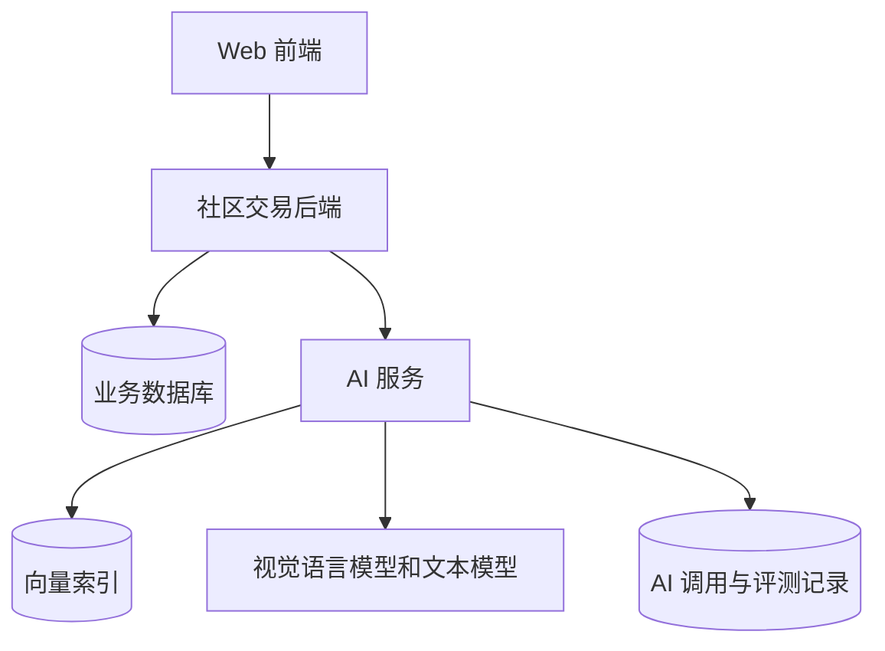

# AI 校园二手交易社区需求初议

**这是总述文档 具体需求可看01-04四个子文档 内容是一样的**

## 目录

- [1 文档目的](#1-文档目的)
- [2 项目概述](#2-项目概述)
- [3 建设目标](#3-建设目标)
- [4 目标用户与需求痛点](#4-目标用户与需求痛点)
- [5 用户角色](#5-用户角色)
- [6 核心业务场景](#6-核心业务场景)
- [7 项目范围与优先级](#7-项目范围与优先级)
- [8 功能需求](#8-功能需求)
- [9 AI 创新点设计](#9-ai-创新点设计)
- [10 产品与 AI 产出链路](#10-产品与-ai-产出链路)
- [11 初步系统设计](#11-初步系统设计)
- [12 测试数据与 AI 评价](#12-测试数据与-ai-评价)
- [13 非功能需求](#13-非功能需求)
- [14 团队任务需求](#14-团队任务需求)
- [15 里程碑与早鸟策略](#15-里程碑与早鸟策略)
- [16 书面报告材料规划](#16-书面报告材料规划)
- [17 现场汇报设计](#17-现场汇报设计)
- [18 主要风险与应对方案](#18-主要风险与应对方案可略读)
- [19 待组内确认事项](#19-待组内确认事项)
- [20 可用于报告的参考研究](#20-可用于报告的参考研究)

## 1 文档目的

本文档用于明确程序设计综合实验的产品方向、目标用户、需求痛点、功能范围、AI 创新点、产出链路、团队任务和验收方法，为后续需求分析、概要设计、详细设计、开发测试、结项报告和现场汇报提供依据。

当前项目只有可复用的社区后端架构，没有成熟的用户、商品、交易和行为数据。因此，核心 AI 功能应尽量避免依赖大规模历史数据，优先选择能够使用当前商品内容和单次交易信息完成推理、容易构造测试集、现场展示效果明确的功能。

## 2 项目概述

### 2.1 暂定名称

**校园易循——AI 校园二手交易社区平台**

项目名称可后续调整。

### 2.2 产品定位

本产品面向在校师生，教职工人员，为教材、数码产品、自行车、宿舍用品等校园闲置物品提供发布、搜索、求购、沟通、交易确认和评价功能。

平台在传统二手交易社区功能基础上，引入 AI 商品发布助手、自然语言搜索与供需匹配、交易确认与风险检查三项能力，降低商品发布成本，提高供需匹配效率，减少因信息缺失和协商内容不一致产生的交易问题。

项目不负责真实在线支付，不以训练大型基础模型为目标，也不把接入大模型接口本身作为创新。AI 必须进入商品发布、搜索匹配或交易确认等具体业务流程，并且能够通过固定测试集进行验证。

### 2.3 校园场景特征

校园二手交易与通用二手平台相比，应体现以下特征：

- 交易用户主要是在校学生。
- 商品集中在教材、考试用品、数码设备、自行车和宿舍用品等类别。
- 需求具有开学季、毕业季和考试季等周期性。
- 交易通常发生在同一校区，（但也支持跨校区交易）线下自提需求明显。
- 买卖双方关注宿舍区、教学区和校门等具体见面地点。
- 平台可采用模拟校园身份认证，不强制接入学校真实统一身份系统。
- 平台应提示用户现场验货，并对提前转账、站外联系等风险进行提醒。

## 3 建设目标

项目需要实现以下目标：

1. 复用现有社区后端架构，补充用户、商品、求购、交易和评价等业务数据。
2. 跑通商品发布、发现、沟通、确认和完成交易的最小业务闭环。
3. 使用 AI 帮助卖家从图片和少量输入生成结构化商品草稿。
4. 使用 AI 将买家的自然语言需求转换为可解释的检索条件。
5. 将商品与求购需求进行双向语义匹配。
6. 从协商内容中提取价格、时间、地点、商品状态等信息，生成交易确认卡。
7. 对信息缺失、条件冲突和典型交易风险给出提示。
8. 建立课程测试集和评价指标，证明 AI 功能的有效性和局限性。

## 4 目标用户与需求痛点

### 4.1 卖家痛点

| 痛点 | 具体表现 | 对应产品能力 |
| --- | --- | --- |
| 发布商品步骤多 | 需要填写标题、分类、成色、价格、描述和自提地点 | AI 商品发布助手 |
| 不知道信息是否完整 | 容易遗漏型号、附件、瑕疵和购买时间 | AI 缺失信息检查 |
| 不擅长描述商品 | 描述过短、重点不清或表达夸张 | AI 客观描述草稿 |
| 商品图片质量差 | 图片模糊、光线差、未展示瑕疵和使用状态 | 图片质量和补拍建议 |
| 重复回答相同问题 | 买家反复询问成色、配件和见面地点 | 商品信息卡和常见问答 |
| 商品难以被发现 | 标题、分类和标签填写不准确 | AI 分类、标签和语义匹配 |

### 4.2 买家痛点

| 痛点 | 具体表现 | 对应产品能力 |
| --- | --- | --- |
| 搜索需求表达复杂 | 需求同时包含价格、用途、成色、校区和时间 | 自然语言条件提取 |
| 商品名称不统一 | 自行车、单车、山地车等表达无法完全通过关键词匹配 | 语义检索 |
| 当前没有合适商品 | 需要反复打开平台搜索 | 求购需求与新商品自动匹配 |
| 商品信息不完整 | 无法判断型号、附件、瑕疵和使用情况 | 信息完整度提示 |
| 难以判断交易风险 | 对方要求提前付款或转到站外沟通 | 交易风险提示 |
| 协商结果容易遗漏 | 最终价格、见面地点和验货要求散落在聊天记录中 | AI 交易确认卡 |

### 4.3 管理员痛点

| 痛点 | 具体表现 | 对应产品能力 |
| --- | --- | --- |
| 商品分类和标签混乱 | 用户随意填写，影响搜索效果 | AI 分类建议与人工确认 |
| 违规内容处理困难 | 可能出现违禁品、广告、辱骂和隐私信息 | AI 风险分类与人工复核 |
| 交易纠纷缺少依据 | 双方对价格、成色和附件理解不一致 | 交易确认卡和操作记录 |
| 商品状态不及时 | 已售商品仍在展示 | 预订、完成和取消状态管理 |
| AI 结果难以解释 | 只返回正常或异常，管理员无法判断依据 | 风险类别、理由和证据片段 |

## 5 用户角色

| 角色 | 主要权限 |
| --- | --- |
| 游客 | 浏览允许公开的商品和求购信息 |
| 注册用户 | 发布商品、发布求购、搜索、私信、报价和评价 |
| 卖家 | 编辑商品、接受报价、确认交易、修改商品状态 |
| 买家 | 收藏商品、提交报价、确认交易、完成评价 |
| 管理员 | 审核举报和风险内容、下架违规商品、查看操作记录 |
| 系统管理员 | 管理分类、AI 配置、调用限制和系统参数 |

一个注册用户可以同时是买家和卖家。

## 6 核心业务场景

### 6.1 AI 辅助发布商品

卖家上传商品图片并填写少量信息。AI 识别可能的商品类别、品牌、外观特征和图片问题，生成标题、标签、描述草稿及待补充字段。用户确认和修改后才能发布，AI 不得直接编造型号、成色、附件和价格。

### 6.2 自然语言搜索商品

买家输入：

> 想买一台一百五十元以内的显示器，能接笔记本，最好在东校区自提。

AI 将需求转换为价格、类别、用途、校区和交付方式等结构化条件，再结合商品描述的语义相似度进行排序。系统应向用户展示主要匹配原因，而不是只返回一个无法解释的分数。

### 6.3 求购与新商品双向匹配

当前没有合适商品时，买家可以保存求购需求。卖家发布新商品后，系统比较商品信息与有效求购需求，向匹配度较高的双方发送站内提醒。

### 6.4 买卖双方私信空间

私信空间是买卖双方围绕具体商品沟通和协商的统一入口。会话必须同时绑定商品、买家和卖家，避免脱离商品上下文的陌生人私信，也便于后续生成交易确认卡。

| 页面或位置 | 入口名称 | 进入后的行为 |
| --- | --- | --- |
| 商品详情页 | 联系卖家 | 创建或打开当前买家、卖家与商品对应的私信会话 |
| 商品详情页 | 发起议价 | 携带初始报价进入同一个私信会话 |
| 卖家的报价或购买意向列表 | 私信买家 | 打开对应商品和买家的会话 |
| 顶部导航栏或移动端底部导航 | 消息 | 进入全局消息中心，查看最近会话和未读数量 |
| 个人中心的我的购买与我的出售 | 继续沟通 | 打开对应商品的历史会话 |
| 交易详情页 | 交易协商 | 返回与该笔交易关联的私信空间 |

私信页面应持续显示商品缩略图、标题、当前价格、交易状态和对方昵称，使双方始终知道正在讨论哪件商品。消息中心应按照最后消息时间排序，并显示未读数量、最后一条消息摘要和商品状态。

同一个商品、买家和卖家组合只保留一个有效会话，重复点击入口时复用原会话。只有会话双方能够读取和发送消息；管理员只有在收到举报或执行有权限的审核任务时，才能查看必要的相关内容。

### 6.5 交易确认与风险检查

买卖双方通过商品对应的私信空间完成协商后，AI 从私信记录中提取最终价格、商品成色、所含附件、见面时间、见面地点、验货方式和待确认事项。系统生成交易确认卡，双方确认后形成交易记录。

如果协商内容出现提前转账、站外联系、价格前后冲突或商品描述不一致等情况，系统给出风险提示，但不代替用户作出交易决定。

## 7 项目范围与优先级

### 必须完成 P0

- 注册、登录和角色识别。
- 模拟校园身份信息。
- 商品分类、商品发布、编辑、上下架和详情展示。
- 商品图片上传。
- 关键词搜索和条件筛选。
- 求购需求发布和管理。
- 买卖双方私信会话和全局消息中心。
- 商品详情、报价列表、个人中心和交易详情中的私信入口。
- 报价、接受报价和交易状态管理。
- 交易完成和双方评价。
- 管理员举报处理和商品下架。
- AI 商品发布助手。
- 自然语言需求解析和商品语义匹配。
- AI 交易确认卡。
- AI 调用异常处理、基础限流和操作记录。
- 课程测试集、测试结果和演示数据。

### 建议完成 P1

- 图片质量检查和补拍建议。
- 商品与求购需求自动匹配提醒。
- 交易条件冲突检测。
- 提前转账、站外沟通等风险提示。
- AI 内容审核与管理员人工复核。
- AI 结果点赞、点踩和纠错。
- 相似商品参考价格区间。

### 时间充足时完成 P2

- 图片搜索相似商品。
- 校园热点品类和季节需求统计。
- 基于用户主动选择兴趣的内容推荐。
- AI 使用情况和效果统计面板。

### 暂不纳入范围

- 真实在线支付和资金托管。
- 接入学校真实统一身份认证系统。
- 训练或微调大型基础模型。
- 基于大量历史行为的协同过滤推荐。
- 缺少成交数据支撑的精确自动定价模型。
- AI 自动封禁用户或执行不可逆处罚。
- 面向互联网大规模用户的生产级高并发部署。

## 8 功能需求

### 8.1 用户与身份

| 编号 | 需求 | 优先级 | 验收说明 |
| --- | --- | --- | --- |
| FR-001 | 系统应支持用户注册、登录和退出 | P0 | 用户能够完成身份认证 |
| FR-002 | 系统应记录昵称、校区和模拟认证状态 | P0 | 可按校区展示和筛选商品 |
| FR-003 | 系统应区分普通用户和管理员权限 | P0 | 普通用户不能访问管理功能 |
| FR-004 | 用户应能查看自己的商品、求购、报价和交易 | P0 | 个人中心数据完整 |

### 8.2 商品与求购

| 编号 | 需求 | 优先级 | 验收说明 |
| --- | --- | --- | --- |
| FR-101 | 用户应能发布、编辑、下架商品 | P0 | 商品状态变化正确保存 |
| FR-102 | 商品应记录标题、分类、价格、成色、描述、图片和自提信息 | P0 | 必填字段校验有效 |
| FR-103 | 用户应能按关键词、分类、价格、校区和状态筛选 | P0 | 多条件组合查询正确 |
| FR-104 | 用户应能发布和关闭求购需求 | P0 | 求购状态正确保存 |
| FR-105 | 系统应支持收藏和简化报价 | P0 | 操作能够被双方查看 |

### 8.3 私信空间与入口

| 编号 | 需求 | 优先级 | 验收说明 |
| --- | --- | --- | --- |
| FR-151 | 商品详情页应提供联系卖家入口 | P0 | 登录用户点击后创建或打开对应商品会话 |
| FR-152 | 发起议价时应将初始报价带入商品会话 | P0 | 卖家可在同一会话中查看并回应报价 |
| FR-153 | 系统应提供全局消息中心入口 | P0 | 用户可查看最近会话、未读数量和消息摘要 |
| FR-154 | 卖家应能从报价或购买意向列表进入对应会话 | P0 | 会话正确关联商品和买家 |
| FR-155 | 买卖双方应能从个人中心和交易详情返回对应会话 | P0 | 已建立的会话可被重新打开 |
| FR-156 | 同一商品、买家和卖家组合应复用同一会话 | P0 | 重复点击不会生成多个平行会话 |
| FR-157 | 私信页应展示关联商品信息和当前交易状态 | P0 | 商品标题、缩略图和状态始终可见 |
| FR-158 | 只有会话参与者能够读取和发送消息 | P0 | 非参与者访问时返回无权限 |
| FR-159 | 用户应能举报会话消息或屏蔽对方 | P1 | 举报进入管理员审核流程 |

### 8.4 交易流程

| 编号 | 需求 | 优先级 | 验收说明 |
| --- | --- | --- | --- |
| FR-201 | 买家应能提交报价或购买意向 | P0 | 卖家可以接受或拒绝 |
| FR-202 | 双方应能在商品私信空间中记录协商内容 | P0 | 交易确认前可查看完整记录 |
| FR-203 | 双方确认后生成交易记录 | P0 | 价格、时间、地点等信息被保存 |
| FR-204 | 商品支持在售、已预订、已完成和已下架状态 | P0 | 状态转换符合业务规则 |
| FR-205 | 交易完成后双方可以评价 | P0 | 每个交易方只能评价一次 |

### 8.5 AI 商品发布助手

| 编号 | 需求 | 优先级 | 验收说明 |
| --- | --- | --- | --- |
| FR-301 | AI 应根据图片和用户输入生成商品草稿 | P0 | 返回结构化字段和描述草稿 |
| FR-302 | AI 应标记无法从图片确定的字段 | P0 | 不得把推测内容当作事实 |
| FR-303 | AI 应检查型号、附件、瑕疵等重要信息是否缺失 | P0 | 返回待补充字段列表 |
| FR-304 | 用户应能修改或拒绝 AI 建议 | P0 | AI 不直接覆盖用户输入 |
| FR-305 | AI 可提示模糊、过暗或展示角度不足等图片问题 | P1 | 返回具体补拍建议 |

商品草稿可采用以下结构：

```json
{
  "category": "数码产品/显示器",
  "title": "戴尔24英寸显示器",
  "brand": "Dell",
  "condition": "待用户确认",
  "detectedAttributes": ["约24英寸", "疑似包含HDMI接口"],
  "missingInformation": ["具体型号", "购买时间", "是否包含电源线"],
  "photoWarnings": ["未展示屏幕点亮状态"],
  "descriptionDraft": "请用户确认后生成"
}
```

### 8.6 自然语言搜索与供需匹配

| 编号 | 需求 | 优先级 | 验收说明 |
| --- | --- | --- | --- |
| FR-401 | AI 应从自然语言中提取商品类别、价格和校区等条件 | P0 | 返回结构化条件并允许用户修改 |
| FR-402 | 系统应结合硬性条件和语义相似度排序商品 | P0 | 不符合价格等硬条件的商品不能错误排在前列 |
| FR-403 | 系统应显示主要匹配原因 | P0 | 用户可理解商品为何被推荐 |
| FR-404 | 当前无结果时用户可以保存求购需求 | P0 | 求购需求可再次编辑和关闭 |
| FR-405 | 新商品与求购需求匹配后可发送站内提醒 | P1 | 提醒包含商品和匹配原因 |

自然语言需求可转换为以下结构：

```json
{
  "category": "自行车",
  "maxPrice": 300,
  "condition": "可正常使用",
  "campus": "东校区",
  "deliveryMethod": "自提"
}
```

### 8.7 AI 交易确认与风险检查

| 编号 | 需求 | 优先级 | 验收说明 |
| --- | --- | --- | --- |
| FR-501 | AI 应从关联商品的私信记录中提取交易关键字段 | P0 | 字段结果可由双方查看和修改 |
| FR-502 | 系统应列出尚未达成一致的事项 | P0 | 不确定内容不能被自动视为已确认 |
| FR-503 | 双方确认后才能生成正式交易记录 | P0 | 单方确认不能完成交易 |
| FR-504 | AI 应识别描述、价格和附件等条件冲突 | P1 | 返回冲突内容及其证据片段 |
| FR-505 | 系统可提示提前转账、站外交易等典型风险 | P1 | 风险提示不自动中止交易 |

交易确认卡可采用以下结构：

```json
{
  "item": "戴尔24英寸显示器",
  "finalPrice": 180,
  "condition": "屏幕正常，外壳有划痕",
  "includedItems": ["电源线", "HDMI线"],
  "meetingTime": "9月25日18:00",
  "meetingPlace": "东校区一食堂门口",
  "inspectionAgreement": "现场通电检查",
  "unresolvedIssues": ["是否支持退换"],
  "riskWarnings": ["对话中出现提前转账要求"]
}
```

### 8.8 管理与审核

| 编号 | 需求 | 优先级 | 验收说明 |
| --- | --- | --- | --- |
| FR-601 | 用户应能举报商品和用户 | P0 | 举报进入管理员待办列表 |
| FR-602 | 管理员应能查看举报依据并作出处理 | P0 | 处理动作和理由被记录 |
| FR-603 | AI 可识别违禁品、广告、辱骂和隐私泄露风险 | P1 | 返回类别、等级、理由和证据 |
| FR-604 | AI 审核结果应由管理员复核 | P1 | AI 不直接执行封禁或永久删除 |

## 9 AI 创新点设计

### 9.1 创新点一 多模态商品发布助手

系统使用商品图片和用户补充文字生成结构化商品草稿，同时检查图片质量和关键信息缺失。它解决卖家发布步骤多、描述困难和信息不完整的问题。

创新性体现在：

- 同时处理图片和文本输入。
- 输出可以直接进入商品发布表单的结构化数据。
- 明确区分图片可确认信息、模型推测和需要用户补充的信息。
- 使用图片质量检查提高商品展示可信度。
- 通过人工确认控制模型幻觉，而不是直接自动发布。

### 9.2 创新点二 AI 求购守望与持续供需匹配

系统允许买家提前保存想购买物品的自然语言需求。首次检索没有找到合适商品时，需求不会随搜索结束而消失，而是转化为持续有效的“求购守望任务”。系统持续监测新发布、重新上架或价格和描述发生变化的商品，发现符合条件的物品后主动通知买家。

例如，买家可以输入：

> 想买一辆300元以内的自行车，能正常骑，最好在东校区自提，毕业季之前都有效。

AI 将其解析为结构化需求：

```json
{
  "category": "自行车",
  "maxPrice": 300,
  "requiredConditions": ["可正常骑行"],
  "preferredCampus": "东校区",
  "deliveryMethod": "自提",
  "hardConstraints": ["category", "maxPrice"],
  "softPreferences": ["preferredCampus", "deliveryMethod"],
  "expiresAt": "毕业季前"
}
```

#### 需求保存与确认

AI 应区分硬条件、软偏好和待确认信息。最高价格、指定类别等硬条件不满足时直接排除商品；校区、距离和自提方式等软偏好用于调整排序；无法确定的内容必须展示给买家确认。买家检查并修改结构化条件后，才能保存求购守望任务。

求购守望任务至少包含有效、暂停、已匹配、已完成、已过期和已取消等状态。买家可以随时修改条件、手动刷新、暂停任务，或在已经买到商品后结束任务。

#### 持续匹配机制

系统采用“商品变化触发为主、定时刷新为辅”的方式持续匹配：

1. 卖家发布、重新上架或修改商品后，系统生成或更新商品的语义表示。
2. 系统查找类别和价格等硬条件可能符合的有效求购任务。
3. 在候选结果中计算商品描述与购买需求的语义相似度。
4. 结合价格符合度、校区符合度、成色、交付方式和商品新鲜度进行排序。
5. 匹配分数超过阈值后保存结果，并向买家发送站内通知。
6. 后台定时任务定期处理失败任务、价格变化、重新上架商品和尚未成功匹配的需求。

这种方式比只按固定时间扫描全部商品更及时，也能降低重复计算。课程项目可以先使用数据库定时任务完成 P0，不强制引入复杂消息队列。

#### 可解释匹配与通知

通知不能只显示一个匹配分数，还应解释商品符合或不符合哪些条件。例如：

```text
匹配度 89%

符合条件：
- 商品类别为自行车
- 售价260元，未超过300元
- 描述注明可以正常骑行
- 支持东校区自提

尚未确认：
- 卖家没有说明轮胎近期是否更换
```

买家从通知进入匹配结果后，可以查看商品、联系卖家或标记“不感兴趣”。点击“联系卖家”时，系统应创建或复用该商品、买家和卖家对应的私信会话，形成“求购守望—匹配通知—商品详情—买卖私信—交易确认”的完整链路。

为避免通知骚扰，系统需要：

- 为每个求购任务设置最低匹配阈值。
- 同一求购任务对同一商品只通知一次。
- 商品没有实质变化时不得重复通知。
- 支持立即通知和每日汇总两种策略。
- 设置每日通知上限和通知冷却时间。
- 在通知中提供暂停需求和已经买到的快捷操作。

#### 用户反馈闭环

买家可以对匹配结果选择“符合需求”“价格不合适”“地点不合适”“类型不对”或“不感兴趣”。P0 阶段可以根据反馈直接修改结构化条件或排除对应商品；后续版本可以据此调整软偏好和匹配权重。即使不训练新的模型，也能形成可验证的反馈闭环。

#### 创新性说明

这一功能不是普通定时查询。其创新点在于：

- AI 将非结构化的长期购买意图转换为可编辑的约束条件和语义表示。
- 系统不依赖成熟用户画像和历史点击数据，适合项目初期的冷启动环境。
- 将一次性的被动搜索扩展为持续工作的需求代理。
- 同时使用可验证的硬条件和语义相似度，降低单纯向量匹配的误报。
- 新商品和已有求购需求能够双向匹配，而不是只向用户推荐热门商品。
- 匹配结果提供原因、未确认项和用户反馈入口，具有可解释性。
- 该功能与商品发布、站内通知、买卖私信和交易确认形成完整业务闭环。

#### 分阶段实现

- P0：保存需求、AI 结构化解析、买家确认、手动刷新、新商品触发匹配、站内通知和匹配去重。
- P1：后台定时刷新、立即通知与每日汇总、匹配原因、任务有效期和用户反馈。
- P2：根据反馈自动调整软偏好和排序权重，并支持更细致的跨类别需求理解。

#### 建议验收指标

| 指标 | 含义 | 初步目标 |
| --- | --- | --- |
| 条件提取准确率 | 类别、价格、校区等结构化字段是否正确 | 不低于90% |
| Recall@5 | 人工标注的相关商品是否进入前5个结果 | 不低于80% |
| 通知准确率 | 通知商品中真正符合需求的比例 | 不低于80% |
| 重复通知率 | 同一需求重复通知同一商品的比例 | 接近0 |
| 匹配延迟 | 新商品发布到产生通知的时间 | 课程环境控制在数秒至一分钟 |

以上数值是项目目标，需要使用人工标注的课程测试集验证，不能在实现和测试完成前写成既有结果。

### 9.3 创新点三 交易协商结构化与风险检查

系统从协商内容中提取交易要素，生成双方共同确认的交易卡，并识别尚未解决的问题、前后矛盾和典型风险。

创新性体现在：

- AI 输出进入实际交易流程，而不是停留在聊天回答。
- 将非结构化协商文本转换为可确认的交易数据。
- 识别商品描述、最终协商和附件条件之间的冲突。
- 保留原对话证据和人工确认，避免 AI 代替用户作出决定。

### 9.4 可选创新点 AI 参考价格区间

系统可以根据项目内同类商品、成色和附件生成参考区间，但不应表述为准确价格预测。由于当前没有真实历史成交数据，此功能只能作为发布辅助，输出必须说明依据和数据限制。

### 不建议作为核心创新的功能

| 功能 | 不建议原因 |
| --- | --- |
| 个性化推荐 | 缺少用户行为和长期兴趣数据，无法证明推荐效果 |
| 精确自动估价 | 缺少真实成交价格和成色标注，容易产生不可信结果 |
| 欺诈用户预测 | 缺少欺诈样本和交易网络，无法训练或验证可靠模型 |
| AI 自动处罚 | 误判风险高，也不适合课程项目直接执行不可逆操作 |

### 9.6 创新点选择比较

评分采用 1 至 5 分，分数越高越适合当前项目。“低数据依赖”和“落地可控”分数越高，表示越容易在缺少真实数据的情况下实现。

| 候选功能 | 用户价值 | 创新性 | 低数据依赖 | 落地可控 | 演示效果 | 建议 |
| --- | ---: | ---: | ---: | ---: | ---: | --- |
| AI 商品发布助手 | 5 | 4 | 5 | 4 | 5 | 核心 |
| 自然语言搜索与供需匹配 | 5 | 4 | 5 | 4 | 5 | 核心 |
| 交易确认卡与风险检查 | 4 | 5 | 5 | 3 | 5 | 核心 |
| AI 参考价格区间 | 5 | 5 | 2 | 2 | 5 | 可选 |
| AI 内容审核 | 4 | 3 | 4 | 4 | 3 | 管理功能 |
| 个性化推荐 | 3 | 3 | 1 | 2 | 3 | 暂缓 |
| 欺诈用户预测 | 4 | 5 | 1 | 1 | 4 | 不建议 |

## 10 产品与 AI 产出链路

### 10.1 商品发布链路


### 10.2 搜索与供需匹配链路


### 10.3 交易确认链路


### 10.4 完整业务闭环

```text
用户注册或登录
→ 卖家发布商品
→ AI 完善商品信息
→ 买家浏览或自然语言搜索
→ 系统匹配商品与求购需求
→ 买家提交报价或购买意向
→ 从商品详情进入买卖双方私信空间
→ 买卖双方围绕该商品协商
→ AI 生成交易确认卡
→ 双方确认交易
→ 商品变为已预订或已完成
→ 双方评价
→ 管理员处理举报和风险内容
```

### 10.5 课设交付链路

```text
需求评审
→ 产品原型和数据库设计
→ 用户与商品基础流程
→ 交易状态闭环
→ AI 商品发布助手
→ 自然语言匹配
→ 交易确认卡
→ 测试集建设和评价
→ 部署与演示准备
→ 完成四类书面报告和答辩材料
```

## 11 初步系统设计

### 系统边界



- Web 前端负责商品、求购、交易和 AI 结果交互。
- 社区交易后端负责身份、权限、商品、报价、交易状态和评价。
- AI 服务负责图片理解、文本结构化、语义匹配、风险检查和模型调用。
- 业务数据库是用户、商品和交易事实的权威数据源。
- 向量索引只保存检索所需向量及关联元数据。
- AI 调用与评测记录用于问题追踪、质量评价和汇报展示。

### 建议数据实体

| 实体 | 关键字段 |
| --- | --- |
| 用户 | 用户 ID、昵称、校区、认证状态、角色、账号状态 |
| 商品 | 商品 ID、卖家 ID、分类、价格、成色、描述、状态、自提信息 |
| 商品图片 | 图片 ID、商品 ID、文件地址、排序、AI 质量结果 |
| 求购需求 | 需求 ID、用户 ID、原始文本、结构化条件、状态 |
| 收藏 | 用户 ID、商品 ID、创建时间 |
| 报价 | 报价 ID、商品 ID、买家 ID、金额、状态 |
| 私信会话 | 会话 ID、商品 ID、买家 ID、卖家 ID、关联交易 ID、最后消息时间、状态 |
| 私信消息 | 消息 ID、会话 ID、发送者 ID、消息类型、内容、发送时间、已读状态 |
| 交易确认卡 | 商品、价格、附件、时间、地点、验货方式、风险项、双方确认状态 |
| 交易 | 交易 ID、商品 ID、买家、卖家、最终价格、状态 |
| 评价 | 交易 ID、评价人、被评价人、评分、内容 |
| 举报与审核 | 目标对象、举报原因、AI 风险、人工结论、处理记录 |
| AI 调用记录 | 功能类型、模型标识、提示词版本、耗时、状态、错误信息 |

### 模型接入原则

- 使用统一模型接口，业务代码不直接依赖单一厂商。
- 模型地址、名称、参数和密钥通过环境变量提供。
- 仓库只提交 `.env.example`，不得提交真实密钥。
- AI 返回尽量采用 JSON 等结构化格式，并进行字段校验。
- 提示词模板纳入版本管理。
- 记录模型调用耗时、成功状态和错误原因。
- 外部模型不可用时，普通商品和交易功能仍应可用。

## 12 测试数据与 AI 评价

### 课程测试集

由于没有成熟用户和历史数据，项目应建立经过人工检查的模拟数据集：

- 不少于 100 条模拟商品，覆盖 8 至 10 个校园常见类别。
- 不少于 30 条自然语言求购需求。
- 不少于 20 组商品图片及人工标注的标准字段。
- 不少于 20 组买卖双方协商记录。
- 不少于 10 组存在条件冲突或交易风险的协商记录。
- 正常内容和违规内容各不少于 20 条，用于审核功能测试。

可以使用 AI 辅助生成文本初稿，但组员必须逐条检查并标注标准答案。报告中应如实称为课程模拟数据集，不能描述为真实校园用户数据。

### 建议评价指标

| 指标 | 评价内容 | 初步目标 |
| --- | --- | --- |
| 商品字段准确率 | 类别、品牌、属性等字段是否与人工标注一致 | 核心字段准确率不低于 85% |
| 缺失信息识别率 | 是否发现型号、附件和瑕疵等缺失项 | 人工抽查达到组内约定目标 |
| 条件提取准确率 | 价格、校区、类别等条件是否正确 | 核心条件准确率不低于 90% |
| 商品匹配 Recall@5 | 标准相关商品是否进入前 5 个结果 | 不低于 80% |
| 匹配解释正确率 | 展示的匹配原因是否真实有效 | 人工抽查不低于 90% |
| 确认卡字段准确率 | 最终价格、地点、附件等是否正确 | 核心字段不低于 90% |
| 风险提示准确率 | 是否识别测试集中的典型风险 | 报告同时给出准确率和误报情况 |
| 任务效率 | 使用 AI 前后完成发布或搜索的耗时差异 | 使用相同任务进行对照演示 |

这些数值是初步项目目标，应在第一轮测试后根据模型能力、样本规模和课程时间调整。最终报告必须同时说明测试方法、数据规模和局限性。

### 核心验收用例

1. 卖家上传图片后，AI 生成商品草稿并指出无法确认的信息。
2. 卖家修改 AI 草稿后成功发布商品。
3. 买家输入包含价格、校区和用途的自然语言需求，系统正确提取条件。
4. 系统返回符合硬条件的商品，并展示匹配原因。
5. 当前无匹配商品时，用户可以保存求购需求。
6. 新商品发布后，系统能够识别与求购需求的潜在匹配。
7. 买家从商品详情点击联系卖家后，进入绑定该商品的私信空间。
8. 卖家从报价列表进入同一个会话，双方可以收发并查看未读消息。
9. 双方能够从全局消息中心、个人中心和交易详情返回原会话。
10. 非会话参与者无法读取或发送该会话的消息。
11. AI 能从私信记录中提取最终价格、地点、时间和附件。
12. 存在前后矛盾时，交易确认卡将其列为待确认事项。
13. 双方均确认后才生成交易记录并改变商品状态。
14. 模型服务不可用时，普通发布、私信和交易功能仍可使用。

## 13 非功能需求

### 13.1 安全与隐私

- 密码必须进行安全散列，不能明文保存。
- API Key、数据库密码和令牌不得提交到 Git 仓库。
- 日志不得记录完整密码、访问令牌和不必要的个人信息。
- 普通用户不能访问他人的私密交易和协商记录。
- 私信会话必须校验当前用户是否为绑定的买家或卖家。
- 首次发起私信应设置频率限制，并支持举报、屏蔽和管理员审计。
- 商品下架或交易完成后应保留必要的历史消息，但是否允许继续发送应由会话状态控制。
- AI 只能处理当前业务允许其访问的数据。
- 页面应提醒用户不要公开身份证、银行卡等敏感信息。
- AI 风险建议必须保留人工复核和用户确认环节。

### 13.2 可靠性

- AI 功能失败不得影响普通商品和交易功能。
- 模型调用需要设置超时、有限重试和清晰错误提示。
- 重复请求可以使用缓存，避免短时间重复调用。
- 商品删除、下架或权限改变后，应同步更新检索索引。

### 13.3 性能

- 普通商品接口不应等待 AI 推理完成后才返回。
- 图片分析和较长对话处理可以采用异步任务。
- 前端应展示 AI 任务的处理中、成功和失败状态。
- 演示环境应提前准备稳定网络和可复用测试数据。

### 13.4 可解释性

- 商品草稿应区分识别结果、模型推测和待用户确认字段。
- 搜索结果应展示主要匹配原因。
- 交易风险提示应显示触发原因和相关内容片段。
- 页面应明确标记 AI 生成内容可能存在错误。

### 13.5 可维护性

- 用户、商品、交易、AI 服务和模型适配保持清晰边界。
- 接口和关键业务状态需要文档说明。
- 提示词、测试集和模型配置纳入版本管理。
- 核心模块具备单元测试或可重复接口测试。

## 14 团队任务需求

### 建议分工

| 角色 | 主要职责 | 主要交付物 |
| --- | --- | --- |
| 项目与后端负责人 | 需求管理、用户商品接口、权限与数据库 | 需求文档、数据库设计、后端基础功能 |
| 交易后端负责人 | 求购、报价、私信会话、交易状态和评价 | 私信与交易接口、状态机、接口测试 |
| AI 负责人 | 图片分析、条件提取、语义匹配、确认卡 | AI 服务、提示词、测试集和评价结果 |
| 前端与测试部署负责人 | 页面交互、联调、自动化测试和部署 | 前端页面、测试报告、部署与演示环境 |


## 15 里程碑与早鸟策略

| 阶段 | 目标 | 主要产出 |
| --- | --- | --- |
| 第一阶段 需求冻结 | 确定 P0 优先级任务的范围、用户流程和三项 AI 功能 | 需求分析、用例、任务分工 |
| 第二阶段 基础交易闭环 | 完成用户、商品、报价、确认和交易状态 | 可运行的非 AI 基础版本 |
| 第三阶段 AI 发布助手 | 跑通图片输入、结构化输出和用户确认 | 发布助手 MVP、字段测试集 |
| 第四阶段 智能匹配 | 完成需求解析、语义检索和匹配解释 | 搜索匹配 MVP、检索测试结果 |
| 第五阶段 交易确认 | 完成确认卡和双方确认流程 | 交易确认 MVP、对话测试集 |
| 第六阶段 测试优化 | 修复问题并形成量化评价 | 功能测试和 AI 质量报告 |
| 第七阶段 交付答辩 | 固化环境、文档和演示脚本 | 四类报告、PPT、演示视频或现场环境 |

可使用两个测试账号完成发布商品、搜索商品、协商、确认和完成交易。纵向链路可运行后，再补充管理后台、页面美化和 P1 功能。不要先同时开发大量孤立页面，最后才开始联调。

## 16 书面报告材料规划

### 需求分析

- 项目背景和目标用户。
- 校园二手交易痛点。
- 用户角色和用例。
- 功能需求与非功能需求。
- P0、P1 和 P2 范围。
- AI 创新点和验收指标。

### 概要设计

- 总体架构和模块边界。
- 前端、后端、AI 服务和数据库关系。
- 主要业务流程。
- 数据库概念设计。
- 权限、安全和异常处理方案。

### 详细设计

- 数据表结构与字段。
- API 请求和响应格式。
- 交易状态机。
- AI 提示词和结构化输出格式。
- 语义匹配流程和排序规则。
- 关键类、模块和异常处理。

### 结项报告

- 项目完成情况和功能截图。
- 小组任务和个人贡献。
- 测试集、评价指标和测试结果。
- AI 功能对照实验。
- 遇到的问题和解决方案。
- 未完成需求、项目局限和后续改进。

## 17 现场汇报设计

建议使用两个普通账号和一个管理员账号，按照同一故事完成演示：

1. 卖家上传显示器图片。
2. AI 生成商品草稿并提示缺少型号和点亮照片。
3. 卖家补充信息后发布商品。
4. 买家输入包含价格、用途和校区的自然语言需求。
5. 系统展示该商品及匹配原因。
6. 买家从商品详情进入私信空间并提交报价，卖家从消息中心回复。
7. AI 生成交易确认卡并指出尚未确认的退换问题。
8. 双方补充信息并确认交易。
9. 商品进入已预订状态，交易完成后双方评价。
10. 管理员查看一条风险或举报记录。
11. 展示固定测试集上的 AI 评价结果。

演示前应准备备用网络、固定测试账号、稳定图片、预置商品和录屏，以防外部模型接口临时不可用。

## 18 主要风险与应对方案（可略读）

| 风险 | 影响 | 应对方案 |
| --- | --- | --- |
| 现有后端只有架构 | 用户、商品和交易功能仍需开发 | 先设计最小数据模型，不照搬大型电商系统 |
| 模型接口不稳定或额度不足 | 开发和演示受阻 | 设置超时、缓存、备用适配器和固定演示数据 |
| 图片识别出现幻觉 | 商品描述失真 | 标记不确定字段，必须由卖家确认后发布 |
| 自然语言条件提取错误 | 搜索结果不符合需求 | 展示结构化条件并允许用户修改 |
| 缺少真实用户数据 | 推荐和估价无法验证 | 核心功能采用低数据依赖方案，建立人工标注测试集 |
| 功能范围过大 | 无法按时形成完整版本 | 先完成 P0 交易闭环，P1 和 P2 延后 |
| 组员职责不清 | 重复开发或遗漏任务 | 每项任务设置负责人、复核人和验收条件 |
| 报告后期集中补写 | 设计与实现不一致 | 每个里程碑同步更新对应报告材料 |

## 19 待组内确认事项

- 最终项目名称。
- 目标学校是否只设一个校区，还是支持多个校区。
- 现有后端架构的技术栈和可复用模块。
- 前端技术栈和成员分工。
- 私信采用轮询、服务器推送还是 WebSocket；P0 至少保证会话入口、历史消息和未读状态完整。
- 在线模型、本地模型或双适配方案。
- 向量索引采用数据库扩展还是独立服务。
- P1 中优先实现风险检查还是内容审核。
- 课程提交截止时间和早鸟提交条件。
- 学校对四类书面报告的具体格式要求。

## 20 可用于报告的参考研究

以下研究可用于说明选题依据和技术可行性。引用时应结合项目实际设计，不应直接把研究结果当作本项目的测试结论。

1. Xiao Ma 等人的点对点二手平台研究分析了用户上传图片质量与商品销售、买家感知信任之间的关系，可用于支持图片质量检查功能的需求依据：[Understanding Image Quality and Trust in Peer-to-Peer Marketplaces](https://arxiv.org/abs/1811.10648)。
2. Andrea Papenmeier 等人整理了包含价格、属性和用途等信息的自然语言商品查询数据，可用于支持自然语言需求解析与检索测试集设计：[Dataset of Natural Language Queries for E-Commerce](https://arxiv.org/abs/2302.06355)。
3. Lucas Bernardi 等人讨论了电商推荐系统持续出现的冷启动问题，可用于说明本项目为何不把依赖大量历史交互的个性化推荐作为核心功能：[The Continuous Cold Start Problem in E-Commerce Recommender Systems](https://arxiv.org/abs/1508.01177)。
4. Nayan Kumar Singh 的研究讨论了从商品图片生成属性和文本描述时的事实一致性问题，可用于支持“结构化输出、标记不确定字段、用户确认后发布”的设计：[A Multimodal, Multitask System for Generating E-Commerce Text Listings from Images](https://arxiv.org/abs/2510.21835)。
