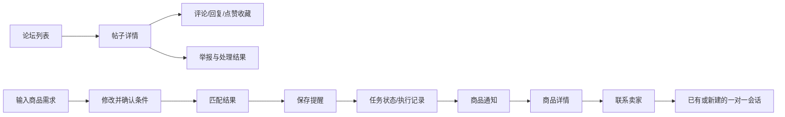

# 页面与操作清单

以下把 HTML 草图展开成开发清单。HTML 用来确认主要布局；本表同时补齐正式版本需要的控件、状态和交互，不把草图里模拟成功当作功能已经实现。

## 一、共同显示规则

- 普通页面：顶部论坛、集市、找商品、我的提醒；账号菜单进入个人中心，版主和管理员另有管理入口。
- 未登录可以浏览公开内容；提交受保护操作时跳登录，保存原来的公开页面地址，登录后返回。私人表单不放到地址栏。
- 表单保留用户已经填写的非密码内容；错误显示在对应字段旁。提交中禁止重复点击，失败解除禁用，不显示虚假成功。
- 列表有加载、空白、失败重试状态。无权限和内容失效使用明确占位，不展示旧正文和旧图片。
- 状态用文字表示，配色辅助。金额界面显示元，提交前精确转成整数分；时间按上海时区显示。
- 标题、正文、图片、任务数量和周期等准确上限执行 T01，不在各页面另设一套。

## 二、页面与操作

| 页面 | 显示和填写什么 | 按钮与跳转 | 对应后端操作 | 拒绝或失败时 |
| --- | --- | --- | --- | --- |
| [首页](../page-drafts/index.html)、[论坛](../page-drafts/forum.html) | 板块、主题、作者、回复数、最后回复；最新/热门/板块筛选与页码 | 主题→详情；发帖→编辑页；板块切换保留条件；公告→只读详情弹窗 | `listBoards`、`listPosts`、`listAnnouncements`、`getAnnouncement` | 加载骨架、空板块、重试；不显示隐藏或删除内容 |
| [帖子详情](../page-drafts/post.html) | 正文安全渲染、附件、评论和父回复；本人点赞收藏状态 | 评论、回复、点赞/取消、收藏/取消、举报；作者编辑删除；版主按板块置顶隐藏 | `getPost`、`listComments`、`createComment`、`deleteComment`、`addLike`、`removeLike`、`addFavorite`、`removeFavorite`、`createReport` | 无效父评论明确提示；删除评论留占位；帖子受限返回不可用，不继续取附件 |
| [发帖/编辑](../page-drafts/compose.html) | 板块、标题、Markdown 正文；图片最多9张，PDF最多2个；编辑带版本 | 上传→预览→发布；编辑→保存；取消返回 | `uploadFile`、`createPost`、`updatePost`、`deletePost` | 标出长度、格式、配额错误；版本冲突提示重新加载，不覆盖他人修改；被隐藏不能编辑 |
| [商品列表](../page-drafts/goods.html) | 图片、价格、成色、校区、卖家；类别、状态、金额和关键词 | 商品→详情；发布闲置；按需求找商品 | `listCategories`、`listCampuses`、`listGoods` | 默认在售；无结果可去找商品或保存提醒；不公开治理下架、删除项 |
| [商品详情](../page-drafts/goods-detail.html) | 型号、用途、明确属性、图片、描述、价格、成色、地点与当前状态 | 买家联系卖家→会话；卖家编辑、预留、已售、下架；举报 | `getGoods`、`openConversation`、`setGoodsState`、`createReport` | 不能联系自己；不可联系时说明；已售不能恢复在售；管理限制解除前不可重新上架 |
| [商品发布/编辑](../page-drafts/goods-edit.html) | 标题、描述、类别、品牌、型号、用途、成色、价格、校区、地点、1～6张图片；可填写手写笔支持等已知属性 | 上传预览、保存、取消；编辑带版本 | `uploadFile`、`createGoods`、`updateGoods` | 价格超范围或多于两位小数拒绝；其他校区必填地点；未知属性不自动填“支持” |
| [找商品/全站搜索](../page-drafts/search.html) | 自然语言或关键词；展示解析出的预算、校区、类别、品牌、型号、成色和明确属性，全部允许修改 | 解析→确认条件→匹配；保存提醒→确认周期；切换公开全站搜索 | `searchPublic`、`parseProductNeed`、`previewGoodsMatches`、`createSubscription` | 解析最多等15秒；失败保留原话并可手填；语义故障标出降为关键词；超预算等不能混进结果 |
| [提醒任务](../page-drafts/subscriptions.html) | 本人条件、周期、启停、上次/下次执行、最近错误、提醒记录 | 新建；暂停；恢复；编辑；删除；查看记录/通知 | `listSubscriptions`、`getSubscription`、`setSubscriptionState`、`updateSubscription`、`deleteSubscription`、`listSubscriptionRuns`、`listSubscriptionMatches` | 任务达到10个提示先删除；编辑前暂停，关窗仍暂停；保存后明确选择恢复；异常可手动恢复 |
| [私信](../page-drafts/chat.html) | 会话、商品上下文、双方文字、发送中/失败/确认、历史和未读 | 发送；原标识重试；滚动补历史；打开会话推进本人已读 | `listConversations`、`getConversation`、`listMessages`、`sendMessage`、`setConversationRead`、`createWsTicket` | 断线提示，不假装送达；重连先补读；失效会话跳登录；不出现上传、群聊或音视频按钮 |
| [通知](../page-drafts/notifications.html) | 本人的商品提醒、举报结果和系统通知；已读/未读 | 查看目标、单条已读、全部已读 | `listNotifications`、`readNotification`、`readAllNotifications` | 目标隐藏删除显示“内容不可用”；商品已售等显示最新状态，不继续推荐 |
| [注册/登录](../page-drafts/login.html) | 自主账号、密码；注册另填昵称、确认密码；不选角色 | 注册成功→登录；登录成功→来源页；忘记密码→辅助重置说明 | `getCsrf`、`register`、`login`、`completePasswordReset` | 账号重复、格式、密码不一致在表单提示；登录失败统一提示；限流显示等待；不显示学校认证标识 |
| [个人中心](../page-drafts/profile.html) | 本人昵称、头像、简介、帖子、收藏、商品、配额和举报处理结果 | 保存资料；换头像；自己的内容进入编辑；密码修改；查看举报结果 | `getMe`、`updateMe`、`changePassword`、`listMyPosts`、`listMyFavorites`、`listMyGoods`、`getFileQuota`、`listMyReports`、`getMyReport`、`logout` | 无权编辑他人；已隐藏内容只可看本人允许的信息；改密后重新登录；文件超额提示 |
| [管理页](../page-drafts/admin.html) | 用户/角色/板块、帖子评论、商品、举报、公告、脱敏任务、操作记录 | 按职责显示处理项；关键操作填写原因并确认；完整操作见 HTTP 目录所有 `admin…` 项 | `adminListUsers` 等管理操作 | 版主仅授权板块；最后可用管理员受保护；不提供全站私聊和私人条件浏览入口 |
| [草图目录](../page-drafts/directory.html) | 草图页面和说明 | 打开相应页面；“草图工具”切换模拟身份与状态 | 无正式接口 | 只供开发讨论，正式站点不展示模拟身份切换 |

## 三、草图尚未逐项模拟的控件，正式版按以下布局制作

这些字段已设计，不要求为了设计阶段先把所有业务写成可用程序。

**个人中心 → 账号安全：**当前密码、新密码、确认新密码、提交按钮；提交成功提示“密码已修改，请重新登录”。辅助重置页为“一次性凭据＋新密码＋确认新密码”，到期或已使用不允许继续。管理员签发凭据时显示一次，要求人工安全交付，不提供公开查询接口。

**发帖 → 附件区：**图片区与 PDF 区分开，列文件名、大小、上传状态和删除按钮；失败文件不进入提交 ID 列表。头像区单独限制2 MiB，商品图和帖子图5 MiB，PDF10 MiB。删除附件先解除绑定，实际清理后释放配额。

**商品编辑 → 补充属性：**型号和用途为文本；支持手写笔等字段选“未填写/是/否”。“未填写”不能被 AI 当成“是”。选择“其他校区”时立即展开地点输入。

**帖子详情 → 回复：**点击某评论“回复”显示被回复对象，提交携带 `parent_id`；取消回复后回顶层评论。编辑入口只对作者可用；置顶/隐藏入口按版面授权显示。

**管理页 → 板块与公告：**板块名称、描述、启用；用户角色及授权板块多选。公告用草稿/发布/撤回，草稿不出现在普通首页。帖子、商品和评论处理表单都必须填写原因；商品管理员只治理，不替卖家改正文或价格。

**通知与举报：**举报人只看自己的处理结果；处理消息骚扰举报时，只展示被举报消息及必要上下文，不设置“打开完整会话”。管理员任务表不展示原始需求和预算校区等私人条件。

## 四、两条主要操作路线

实际字段见 [接口说明](03_接口与消息约定.md) 与 [HTTP 操作目录](HTTP操作目录.md)，角色和状态见 [第04份说明](04_权限状态与共同匹配.md)。
