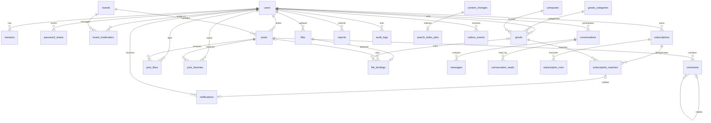

# 要保存的信息与关系

目标数据库为 MySQL 8.4，长期业务数据以它为准。Redis 用于限流、实时连接票据、缓存及可重建的运行信息，不作为消息、任务和通知的唯一保存位置。

## 一、统一写法

| 内容 | 约定 |
| --- | --- |
| 编号 | MySQL `BIGINT UNSIGNED`；接口统一传十进制字符串，避免网页大整数精度问题 |
| 金额 | 整数分，范围0～9,999,999；界面0～99,999.99元；不使用浮点金额 |
| 时间 | `DATETIME(6)` 按UTC写入，连接设置 `+00:00`；接口RFC3339带 `Z`；界面上海时区 |
| 文本 | `utf8mb4`；应用按Unicode码点检查长度；密码不去空格不截断；普通空白正文拒绝 |
| 并发编辑 | `version`/任务 `config_version`；提交旧版本返回409，不静默覆盖 |
| 删除 | 帖子/商品软删除，任务状态deleted；历史消息、任务去重和审计不连带删除 |
| 文件 | 数据库存ID、归属、真实类型、大小、摘要和内部存储键；不存用户提供的磁盘路径 |
| 运行凭据 | 密码仅Argon2id；随机会话/重置凭据只保存SHA-256摘要，不存明文 |

完整列类型、外键和索引见 [schema.sql](schema.sql) 与 [数据字段字典](数据字段字典.md)。数据库不能独自表达的权限、数量限制和状态规则由同一业务事务落实。

## 二、各类表负责什么

| 表 | 保存什么、关键规则 |
| --- | --- |
| `users` | 自主账号归一值、密码哈希、昵称简介、角色、封禁状态、改密要求、文件用量和编辑版本；账号唯一 |
| `sessions` | 登录令牌摘要、用户、创建与绝对到期、撤销；7天不续期 |
| `password_resets` | 一次性重置摘要、签发管理员、有效期、消费和撤销；30分钟 |
| `boards`、`board_moderators` | 板块名称描述和启用、版主管理哪些板块；用户角色与版面分配在事务中一起改 |
| `goods_categories`、`campuses` | 商品类别和校区字典；初始沙河、西土城、其他；不物理删除在用选项 |
| `posts`、`comments` | 帖子正文、板块、作者、置顶及可见性；评论父子关系；父评论组合外键阻止跨帖回复 |
| `post_likes`、`post_favorites` | 用户与帖子的关联，组合主键防止重复点赞收藏 |
| `goods` | 卖家、价格、类别、校区、型号用途、成色、已知属性、交易状态和治理限制；已售为终态 |
| `files`、`file_bindings` | 上传文件和头像/帖子/商品的绑定；一份文件只绑定一个目标；头像仅1个，图片/PDF的序位分别唯一 |
| `conversations` | 两人的排序编号、会话最后序号和最近相关商品；两人组合唯一，不能自己和自己聊天 |
| `messages` | 文字、发送者、会话内序号、客户端消息UUID及正文摘要；两组唯一键处理重试和补读 |
| `conversation_reads` | 每个会话成员已读到哪条；只前进、不超过已存在消息 |
| `subscriptions` | 本人原始需求、确认条件JSON、周期、状态、版本、下次检查、游标、租约和重试信息；条件私有 |
| `subscription_runs` | 某一周期的每次尝试、条件版本、租约、扫描上界、开始结束和安全错误码 |
| `scheduler_slots` | 两个全局执行槽，控制最多同时执行2个任务；槽租约120秒 |
| `subscription_matches` | 哪个任务已经提醒过哪个商品；任务＋商品唯一，改条件不删除 |
| `notifications` | 接收者、来源匹配、目标、简短安全摘要、已读时间；匹配来源唯一 |
| `reports` | 举报人、四种目标之一、原因、必要上下文、处理人和结果；消息上下文最多5条，由服务器截取 |
| `announcements` | 公告草稿/发布/撤回、正文、版本与发布时刻 |
| `audit_logs` | 谁因为什么处理了哪个对象，允许记录的状态变化和请求编号；不存凭据、私聊正文和私人需求 |
| `content_changes`、`system_counters` | 帖子与商品变更编号；计数器锁持有到提交，使序号按提交顺序发布，避免增量漏读 |
| `search_documents`、`search_index_jobs`、`consumer_offsets` | 搜索源版本、向量键、模型维度、索引任务和处理位置；不索引私聊、任务和通知 |
| `outbox_events` | 与消息或通知同事务写入的待推送引用，提交后发送；失败后可重试，接收者＋类型＋来源唯一 |
| `system_locks` | 串行处理管理角色与封禁等操作，防止两个请求同时移除最后可用管理员 |

这些是一个数据库中的表，不需要部署同等数量的服务。初版仍是一套 Rust 后端。

## 三、关系图

会话中的两名成员由 `user_low_id < user_high_id` 明确保存；图中 participants 线是简化表示。文件绑定的头像用户、帖子、商品三者必须且只能选一个，SQL的CHECK约束负责这一点。

## 四、主要字段的含义

- `attributes`：只接受已定义的已知商品事实，如 `stylus_support: true/false/null`、`storage_gb`。未填写为null，不能推断成支持。
- `conditions`：固定第04份说明的 `schema_version:1` JSON，金额为分、校区为code；不使用页面中文标签作为后端枚举。
- `source_version`：搜索数据来自哪个帖子/商品版本；旧索引不能覆盖新源版本。
- `safe_reference`：只存消息ID、会话ID、通知ID等定位信息；推送时重新取有权读的数据，不把私人正文复制进通用日志。
- `necessary_context`：服务器根据举报者当时权限截取；消息只取被举报项和最多前后各2条，与举报一同保存。不是任意会话查询授权。
- `safe_changes`：只保存白名单字段（状态、角色、板块分配等）的前后值；私聊正文、密码和原始需求一律不写入。
- `used_file_bytes`：所有已成功保存且未清理文件的总和，含暂存和待清理；真正清理后才扣减。

## 五、必须一起保存的内容

| 操作 | 一个事务里必须完成 |
| --- | --- |
| 发布或修改内容 | 内容、附件绑定、版本及content_changes；失败不生成可访问半成品 |
| 发消息 | 会话序号、message、outbox；成功提交后才向客户端确认 |
| 找到新商品 | 任务状态/版本/租约校验、去重匹配、通知、outbox、成功游标及执行结果 |
| 处理举报 | 结果、给举报人的通知、outbox及审计；具体隐藏/下架命令另有自己的事务 |
| 封禁/改密/重置 | 用户状态、会话撤销、必要的任务暂停、重置凭据状态及审计 |
| 授权/封禁管理员 | 先锁system_locks的administrators，再检查最后可用管理员及写变更 |

普通事务先锁涉及的用户行（ID升序），再锁任务/会话或内容，再处理附件、匹配、通知等；任务领取在用户和任务之后锁执行槽。写content_changes时最后领取全局变更序号，持锁到提交。所有路径统一顺序，避免一条先锁任务、另一条先锁用户。死锁或版本冲突不得重放收费模型调用。

## 六、搜索与增量的边界

`search_documents` 只保存公开内容的索引定位和源版本，向量放到可替换适配器；具体提供商、维度和模型用配置记录，4.8接入时验证。基线强制语义能力，不把它降为可选。

发布、编辑、隐藏、删除帖子或商品，都在源事务里追加content_changes。使用计数器行锁，避免“先拿到自增编号的事务晚提交，消费者已经越过它”而漏数据。任务按变更区间取商品ID去重，再按数据库当前信息匹配；首次或改条件全量扫。成功才推进游标，失败、取消不推进。

原始文件在私有目录；HTTP读取必须查绑定和当前可见性，不能把上传目录直接公开。索引、缓存和历史通知中的旧标题不得绕过源记录权限。

外键不采用级联删除，保留消息和治理证据；大规模历史清理不是本次设计的默认动作。正式迁移、备份和恢复演练在后续阶段完成。
