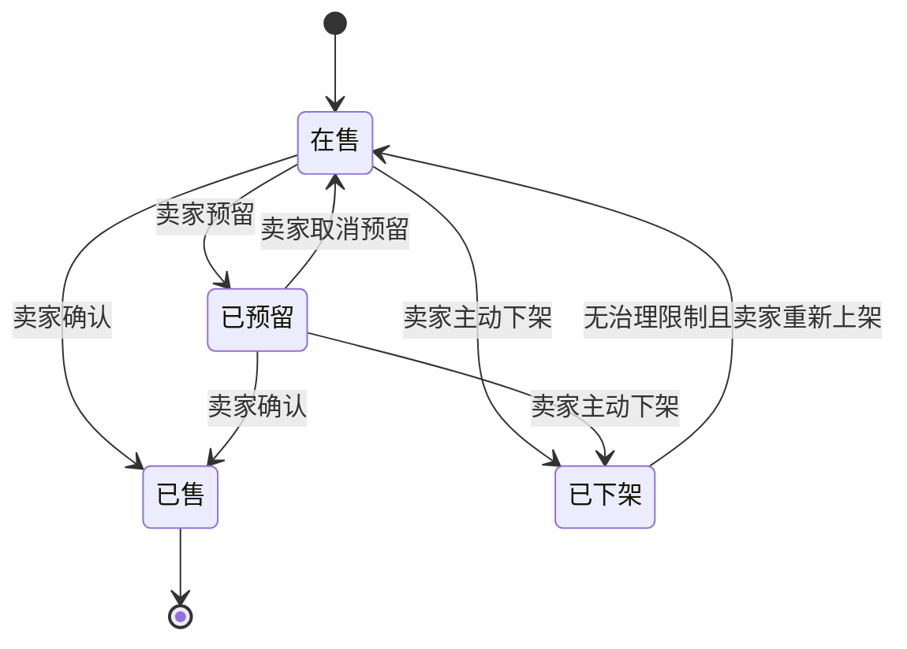
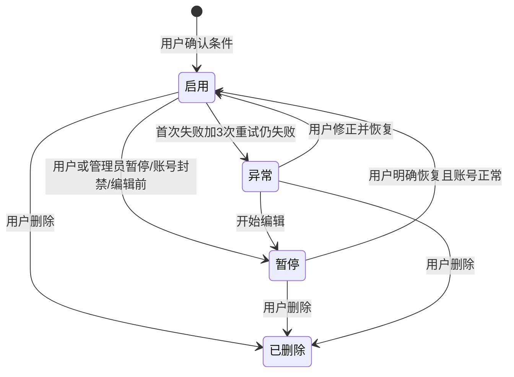

# 权限、状态和共同的商品匹配

## 一、权限落在后端哪里

| 身份/资源 | 后端检查 | 禁止的操作 |
| --- | --- | --- |
| 游客 | 只读公开帖子、商品、公告和搜索；文件继承当前目标可见性 | 写内容、读私聊、查看任务和私人通知 |
| 普通用户 | 会话有效且账号正常；作者/卖家/接收者/任务owner与当前用户一致 | 修改别人正文、商品、通知和需求 |
| 版主 | 普通用户权限；帖子/评论/举报所属板块出现在board_moderators | 管未授权板块、管理商品/用户、处理私人消息举报 |
| 管理员 | 全站治理、授权、公告及审计；重要修改必须有原因 | 代作者改正文或商品价格；默认浏览全部私聊、原始需求和私人条件 |
| 会话与消息 | 当前用户必须等于user_low_id或user_high_id，发送者只能取会话身份 | 根据猜到的会话ID取消息；管理员绕过成员检查 |
| 附件 | 暂存只上传者可读；公开目标可公开读；隐藏目标仅作者/对应职责的治理查看者能通过受控规则读取；删除目标普通读取不可用 | 直接公开磁盘目录、信任用户提供的storage_key、靠旧缓存或直链绕过治理 |
| 消息举报 | 举报者必须是接收者；管理员仅看该举报的必要上下文 | 把必要上下文扩展成整段会话查询授权 |

每个HTTP操作的身份类型和额外检查写在HTTP目录/OpenAPI；WebSocket每次业务帧也走同一命令。前端隐藏按钮只负责体验，不能承担真实权限。

## 二、状态变化

### 商品



治理限制与交易状态分开保存。管理员restrict设为restricted；非已售商品同时设为off_shelf，已售商品保留sold终态。release只解除限制，不自动上架，也不恢复已售。已售终态不可更改商品内容重新发布，另发新商品才是新记录。任何状态可由卖家软删除，删除后无新匹配。

公开列表默认在售，用户可主动看预留/已售/主动下架。治理限制和删除不公开；AI匹配和监控只接受未删除、未治理限制的在售商品。

### 帖子、评论和公告

- 帖子/评论公开→隐藏由版面职责管理者执行；隐藏→公开先确认未删除；作者不可修改隐藏内容绕过处理。
- 作者删除保留结构和治理记录；评论删除以占位展示，正文不返回。删除不是隐藏，不通过restore恢复。
- 公告draft→published→retracted；撤回后可编辑再发布。已发布公告修改正文前先撤回，防止页面缓存误以为旧公告仍有效。
- 用户封禁不自动隐藏全部旧内容，是否隐藏/下架另行治理。

### 商品提醒任务



启用/暂停/异常都计入每人10个未删除任务上限。执行中属于一轮run，不是用户任务的第五种状态。编辑先暂停，关闭编辑窗仍暂停；保存时明确选择是否恢复。

### 账号与管理员保护

封禁：账号banned，全部会话撤销，有效任务暂停，旧实时连接5秒内关闭；解封不自动恢复任务。改密/重置同样撤销全部会话。

“可用管理员”指角色admin、账号active且不处于强制重置限制。授权、封禁、签发重置等会减少可用管理员的操作先锁system_locks的administrators行，检查变更后至少剩1人；禁止通过两个并发请求各自看到另一个管理员而清空管理能力。重置本人走本人改密，不用管理员签发接口。

## 三、搜索和提醒共用什么条件

唯一结构为 `Conditions`，由OpenAPI和以下示例定义：

```json
{
  "schema_version":1,
  "min_price_cents":null,
  "max_price_cents":250000,
  "campus_code":"shahe",
  "category_id":"1",
  "brand":"Apple",
  "model":null,
  "min_condition":"good",
  "required_attributes":{"stylus_support":true},
  "purpose":"记笔记"
}
```

null表示未指定，不用“预算不限”等中文字符串替代。min/max都存在时min≤max，0表示免费商品上限，不视为未填写；类别/校区必须是有效字典。未知字段拒绝，不能把AI任意输出直接存入任务。

**硬条件：**明确的预算区间、校区、类别、品牌、型号、最低成色、required_attributes。品牌/型号按去首尾空白、统一大小写的规范值精确比较；型号需要包含关系时先让用户确认成明确条件，不交给相似度自行放宽。成色排序new＞like_new＞good＞fair。缺少硬条件所需的事实就不匹配，不能由模型猜测。

**软条件：**用途等语义描述，用于通过硬条件后的召回和排序。解释只引用实际商品事实；rank_score是排序分，不显示为成功率或匹配百分比。

### 共同函数约定

```text
match_goods(conditions, candidate_scope, context)
  conditions: 已校验的 Conditions
  candidate_scope: 全量，或给定商品ID集合
  context: 预览/任务、调用用户、条件版本、排序模型版本
  returns: 商品ID、源版本、硬条件证据、排序分、可展示理由
```

执行顺序：可见且在售→价格/校区/类别等精确过滤→语义召回和排序→再查源记录的状态、权限、版本→返回理由。使用过滤后的候选做语义排序；向量适配器支持过滤时可提前下推，同时保留最终精确复核，避免“先取全站少量Top-K再过滤”漏掉合格商品。

预览接口和任务执行调用同一个函数。预览可分页，后台不能只看页面前5条：候选分批处理，去重汇总，在60秒预算内完成；超时则本轮失败、不推进游标。既定验收数据500件商品可先全量过滤后批量排序，之后再优化。

解析模型只提出草稿，不自动确认或创建任务。最多15秒、不重复收费重试；出错可手填相同结构。原始私有需求不放URL/日志/公共索引，任务确认后保存条件，轮询不重新解析。

## 四、一轮商品检查怎么完成

1. 读取到期候选任务。按统一锁顺序核对账号和任务状态，领取task与两个scheduler_slots之一；写run，保存config_version和随机lease_token。单轮60秒、租约120秒，时间以数据库UTC为准。
2. 从已提交的全局content_changes计数器读上界H。首次或改条件后全量；其余只取 `(cursor,H]` 内变更的商品ID。变更编号由计数器行锁串行发布，不直接拿可能乱序提交的自增ID做游标。
3. 在事务外做匹配，不持长事务调用模型；不重复解析原始需求，不把未确认字段加入条件。
4. 提交事务再次按顺序锁用户、任务、执行槽及待写商品行，检查用户未封禁、任务active、config_version一致、lease_token一致且未到期；逐条复核商品在售及硬条件。
5. 为未提醒商品插入subscription_matches，数据库任务＋商品唯一键兜底；同事务写通知和outbox。若任一写入失败，整个事务回滚。
6. 成功记录run、推进游标至H、清重试状态并设置下一次周期；不重复补跑停机错过的每一轮。提交后推送；网络失败不撤销已保存通知。

暂停、删除、修改条件和封禁会使旧轮次提交资格失效。旧工作线程即使计算完成，也必须在第四步发现版本/令牌不同而取消，不能在暂停后补发通知。解除治理、重新编辑商品不清空匹配去重表。

失败沿用同一个cycle_key，attempt_no从0到3；等待分别1、5、15分钟。退避期间不启动新周期；三次额外重试仍失败，任务error。暂态错误只存安全代码；账号失效、暂停或版本变化记cancelled，不当作业务失败收费重试。

进程重启或租约到期后可回收；回收使用新的令牌，旧令牌无法提交。Redis清空后从MySQL的任务、run、执行槽、通知和outbox恢复，已成功保存的数据不丢失。

## 五、索引、缓存、文件和推送的一致性

- 隐藏/删除/下架先改源数据及版本，再异步更新索引；每次结果返回和通知提交前都核对源记录，不等待向量更新才能生效。
- 索引写入使用源版本；旧任务不能把旧向量覆盖回新记录。更新目标60秒内，失败可观察并重试，不展示私有内容作为降级结果。
- 商品治理/删除引起附件访问变化，文件路由与正文使用同一授权判断；浏览器发304也先鉴权。
- outbox保存推送引用并重试。客户端按持久消息/通知ID去重；重连通过HTTP补读。当前记录不可见时不发送旧正文。
- 任务唯一匹配、消息唯一客户端标识、点赞收藏组合键都保留，不能用“看起来收到一次”的页面状态替代数据库约束。

数据库约束能力参考 [MySQL 8.4 CHECK 说明](https://dev.mysql.com/doc/refman/8.4/en/create-table-check-constraints.html)。账号、跨行数量、父资源归属及最后管理员等检查仍必须由应用事务完成。
