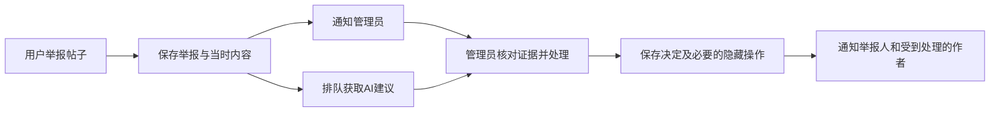

# 帖子举报与 AI 辅助处理

日期：2026 年 10 月 29 日。状态：**待实现的增补设计**。本文不表示举报或 AI 已上线。

## 一、这次要完成什么

让用户在帖子中举报，让管理员收到提醒、查看证据并作出决定，最后将处理结果告诉相关用户。先完成人工处理，再接入 AI 建议。AI 不直接隐藏帖子、封禁用户或判定举报成立。

本次只做帖子举报。评论、商品、私信举报继续放在计划书 4.10；私信不进入本次 AI 调用。AI 调用方式见 [共用接口](07_共用AI调用接口.md)。



## 二、网页上怎么使用

| 页面 | 需要增加的内容 |
| --- | --- |
| 帖子详情 | 在点赞、收藏旁放“举报”；未登录时引导登录 |
| 举报表单 | 原因类别、补充说明、提交按钮及成功编号；不让用户改写帖子快照 |
| 我的举报 | 只看自己提交的举报、处理状态和公开处理说明 |
| 管理员导航 | “举报处理”入口及待处理数量 |
| 举报处理列表 | 按状态、板块和时间筛选；同一帖子合并展示数量，但每条举报保留独立记录 |
| 举报处理详情 | 举报原因、当时内容、当前内容、内容是否修改、AI建议、证据及管理员操作 |
| 站内通知 | 管理员可打开有权处理的举报；举报人可打开自己的结果 |

举报类型：广告或垃圾信息、辱骂或人身攻击、泄露个人信息、疑似诈骗、其他。原因和说明合并后的文本遵守现有 1～1,000 字符限制；如新增类别字段，由后端校验固定选项。

管理员提供三个明确操作，均要求填写说明：

| 操作 | 举报结果 | 对帖子的影响 |
| --- | --- | --- |
| 成立并隐藏帖子 | `resolved` | 隐藏帖子 |
| 成立，暂不隐藏 | `resolved` | 保持当前状态，不自动恢复已隐藏内容 |
| 举报不成立 | `dismissed` | 保持当前状态 |

待处理仍为 `pending`。AI 分析状态单独展示，不替代举报状态。举报数量只作参考，不按数量自动隐藏。多人举报同一帖子时，处理一条不代表其他举报已全部裁定；需要批量处理时逐条检查版本和结果。

## 三、提交时保存什么

复用已有 `reports`，保存举报人、帖子、原因、当时的必要内容、处理状态、处理者、说明和版本。`necessary_context` 由后端生成，至少包含帖子编号、版本、板块、标题、正文、附件引用及截取时间；附件引用不复制文件，不绕过文件权限。

提交时重新检查用户状态和帖子可见性；不能用任意帖子编号读取无权访问的内容。锁定举报用户行后检查同一用户、同一帖子是否已有待处理举报，有则返回已有编号，无则创建。所有提交路径使用同一锁顺序，解决重复点击和并发提交；不能只在前端禁用按钮。

提交事务里保存举报、管理员的持久通知和对应 outbox 事件；启用 AI 时同时保存可恢复的 AI 任务。事务提交后才向用户报告成功。管理员离线时也不能丢失举报或提醒。

举报原因原文只供本人和有权处理者查看。帖子作者看不到举报人的身份、账号或其他人的举报详情。

## 四、管理员如何收到提醒

复用站内通知与 WebSocket 提示，不依赖打开管理页才发现举报。首版通知当前可用管理员；授权版主可在职责范围内查看、处理本板块帖子举报，不能访问其他板块。

现有实现有两处需要补齐：

1. 通知读取对 `report` 目前只检查举报人身份，需要增加当前管理员或授权版主的职责检查。通知不是永久授权；撤销角色或板块权限后，旧通知也不能打开举报内容。
2. 网页通知目前只为帖子和商品生成链接，需要补 `/admin/reports/{id}` 与 `/me/reports/{id}` 的合适入口；后端仍要再次检查权限。

新举报提醒可使用现有 `system` 通知类型；给举报人的处理结果使用 `report_result`。通知只含必要说明，不广播举报理由原文或举报人身份。

作者被隐藏的帖子不再公开，不能依赖公开帖子链接解释处理原因。给作者保存不含举报人信息的处理通知，可使用无公开目标的系统通知，并引导从“我的帖子”查看当前状态。该通知描述已发生的管理操作，不能把过去状态当作当前状态。

## 五、AI 如何辅助

使用共用任务 `reports.review_post`，输入经过筛选和必要脱敏的标题、正文、举报原因以及平台社区规则。第一版只分析文字，页面写明“AI 未分析图片和 PDF”；附件由管理员查看。

先制定并标记一份平台社区规则版本，覆盖垃圾信息、人身攻击、隐私泄露及可疑交易。它是本平台处理依据，不冒充学校官方规定。对于真假、诈骗等不能仅靠文字确认的事项，AI只能提示疑点和待核实内容。

输出示例仅表示字段约定，不代表真实分析：

```json
{
  "assessment": "suspected_violation",
  "category": "abuse",
  "evidence": [{"source": "body", "quote": "原文中的具体片段"}],
  "explanation": "该片段疑似针对其他用户进行侮辱，需要结合上下文核实。",
  "suggested_action": "manual_review",
  "uncertainties": ["无法仅凭帖子确认双方此前的交流情况"]
}
```

`assessment` 只允许疑似违规、未发现明确问题、信息不足；建议只允许人工复核、保留、建议隐藏。证据必须能在发送给模型的文本中找到，无法核对、字段错误或超长输出均不能显示成有效结论。不把模型自报分数当成真实准确率。

AI 异步运行，不阻塞举报提交。无密钥、未启用、超时、限流、返回错误或任务拥堵时，显示“AI暂不可用，可人工处理”。管理员不需要等待AI才能裁定。

任务保存帖子版本和输入摘要。帖子修改后旧分析标记为过期，管理员同时看到原始证据与当前内容，需要时重新分析；不能用旧建议直接裁定新内容。分析前再次检查当前内容是否仍允许发送，已删除、隐藏或超出允许范围时跳过外部调用，转人工处理。

不要仅按帖子编号复用分析：举报原因、内容版本、规则、提示词和模型设置不同，都可能需要不同结果。已处理的举报不继续启动无用分析。模型无权执行管理操作，帖子或举报中的指令也不能变成系统指令。

## 六、怎样保证处理结果一致

“成立并隐藏”必须把举报结果、帖子隐藏、帖子版本与 `content_changes`、对应通知、outbox和审计放在同一数据库事务中。复用帖子治理的检查和写入方法，但不能在一个HTTP请求中依次调用两个会分别提交的接口，再声称它们一起成功。

同时检查举报版本、帖子版本和处理者当前权限。两个管理员同时处理时，一个成功，另一个收到版本冲突并刷新。帖子已删除或状态变化时先展示当前事实，不作无效隐藏；仍可根据已存证据记录举报裁定，但必须说明采取的实际操作。

事务中的锁顺序继续遵守 [数据设计](02_数据与关系.md)。任何重试都不能重放付费 AI 请求。帖子隐藏后继续使用原有搜索、附件和内容可见性规则，公开旧链接也要受权限控制。

## 七、接口及数据增补

沿用既有规划路径：

| 接口 | 用途 |
| --- | --- |
| `POST /api/v1/reports` | 提交帖子举报，后端截取必要证据 |
| `GET /api/v1/me/reports`、`/{id}` | 只读本人举报及结果 |
| `GET /api/v1/admin/reports`、`/{id}` | 按当前职责查看待办和详情 |
| `PATCH /api/v1/admin/reports/{id}` | 保存裁定及可选的帖子隐藏操作 |
| `POST /api/v1/admin/reports/{id}/ai-review` | 有权处理者请求重新分析，受去重、额度和当前内容检查 |

处理接口在原 `state`、`resolution`、`version` 基础上，拟增加 `post_action` 和必要的 `post_version`，支持一次事务完成隐藏。AI任务由后端选择，浏览器不直接指定模型、密钥、提示词或任意任务。

新增 AI 工作记录使用 [共用任务记录](07_共用AI调用接口.md)，不要给每个功能各建一套连接和任务系统。举报类别、实际处理动作及AI结果引用等字段需要补充时，使用新的正式迁移，不改写0001—0005。

这些增补尚未进入可执行契约。实现时同步修改 `build_contracts.py`，再生成 OpenAPI、HTTP目录及相应页面映射；不能只改生成文件。现有报告状态三种不变。

## 八、开发顺序与验收

1. 先做帖子举报、我的举报、管理员列表和详情、人工裁定及结果通知，可独立使用。
2. 在4.8建立共用AI接口后，接入文字分析、状态提示和人工重新分析。
3. 检查重复与并发提交、跨板块越权、撤销管理员权限、并发裁定、隐藏后的搜索和旧附件链接。
4. 检查模型错误、超时、异常输出、引用不存在、帖子修改及重启恢复；任何失败都不阻断人工处理，也不自动隐藏帖子。
5. 小批量标注帖子，记录AI建议与人工判断的差异，尤其是误报和信息不足，不宣称AI可直接裁定。

帖子举报从原4.10提前，作为4.8期间并行推进的管理功能；4.8原有语义搜索、商品匹配范围保留。后续举报类型、公告及完整管理仍在4.10。
