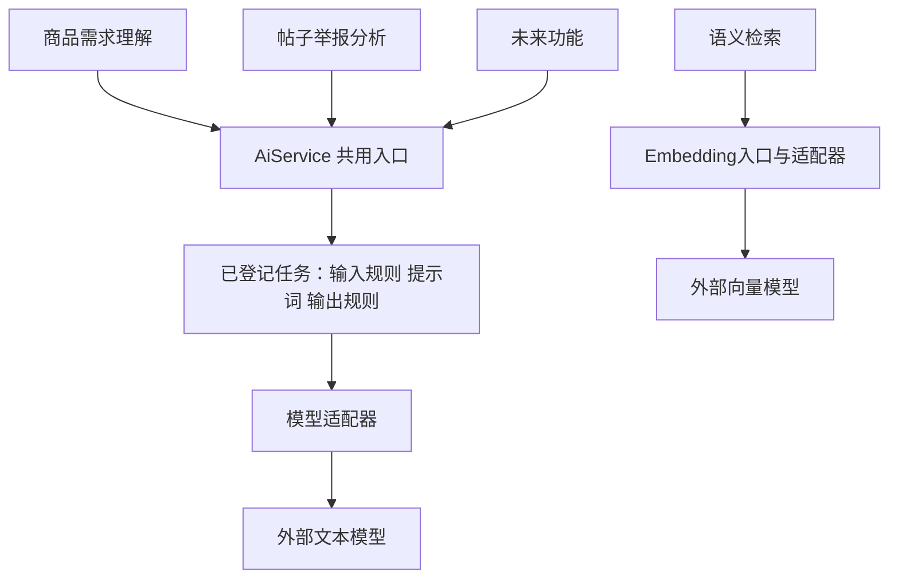

# 共用 AI 调用接口

日期：2026 年 10 月 29 日。状态：**待实现的接口设计**。这里约定后续怎样扩展，尚未增加运行代码、外部连接或真实密钥。

## 一、为什么留这一层

商品需求理解、帖子举报分析以及以后可能增加的功能，都通过同一套后端入口调用模型。连接地址、模型、密钥、超时、额度、调用记录和结果校验集中处理；每个功能只负责自己的权限、输入和输出。

它放在现有 Rust 后端内部，不为课程设计新增独立 AI 服务器。文本生成与 Embedding 分开提供能力，允许使用不同服务商或不同模型，不能假定同一个接口同时支持两者。



## 二、业务代码调用什么

以下是接口约定示意，具体Rust类型在实现时确定：

```rust
AiService.run_task(task_kind, typed_input, call_context)
    -> Result<ValidatedTaskResult, AiError>

AiService.embed(authorized_texts, embedding_context)
    -> Result<ValidatedEmbeddings, AiError>
```

| 项目 | 含义 |
| --- | --- |
| `task_kind` | 后端登记过的任务，如 `goods.parse_query`、`reports.review_post` |
| `typed_input` | 该功能允许的结构化输入，不接收浏览器提供的任意系统提示词 |
| `call_context` | 请求编号、当前调用者、来源版本、去重键、截止时间；不含密码和会话令牌 |
| 返回结果 | 已校验的业务数据、模型与规则版本、可用时的用量及调用编号 |
| `AiError` | 未配置、任务不支持、超时、限流、服务失败、输出无效、输入过期、调用结果未知等固定类别 |

同步任务用于商品需求理解，沿用整个业务调用最迟15秒返回或降级的要求。异步任务用于举报分析：提交举报时保存任务，工作进程领取后执行一次有限时长的模型调用，网页查询任务状态。两种方式共用适配器、输入限制和输出校验。

浏览器只访问各自业务接口，例如商品解析或管理员举报分析；**不开放任意公众可用的 `/ai/run` 模型代理**。当前身份、资源权限、额度和允许发送的内容，必须由服务端决定。

## 三、新增一个功能需要做什么

1. 在任务登记表增加任务名及功能开关，声明需要文本生成还是向量能力。
2. 定义输入、允许的数据范围和输出字段；规定失败时用户怎样继续操作。
3. 编写该任务的提示词、规则和版本，登记输出校验方法。
4. 在业务接口验证身份和权限，准备允许发送的文本，再调用共用入口。
5. 增加正常、无密钥、失败、异常输出、权限及额度检查。

不需要重新编写HTTP连接、复制密钥配置或修改其他功能的业务逻辑。新增任务仍然需要自己的业务代码和测试，不能只靠增加一段提示词就默认可用。

建议目录如下，均为待新增文件位置：

```text
services/api/src/ai/
├─ mod.rs             共用入口与依赖注入
├─ config.rs          服务商、模型、开关和限制
├─ provider.rs        文本模型与向量模型的适配约定
├─ providers/         实际服务商的请求与响应转换
├─ tasks/             已登记任务、提示词和输入输出规则
├─ jobs.rs            异步任务保存、领取和恢复
└─ errors.rs          固定错误类别及可公开的提示
```

## 四、配置怎么留

配置名是拟定示例，不代表已加入当前运行环境：

```dotenv
AI_ENABLED=false
AI_TEXT_PROVIDER=TO_BE_SELECTED
AI_TEXT_BASE_URL=https://YOUR_PROVIDER
AI_TEXT_MODEL=TO_BE_SELECTED
AI_TEXT_API_KEY=SET_ONLY_ON_SERVER
AI_EMBED_PROVIDER=TO_BE_SELECTED
AI_EMBED_BASE_URL=https://YOUR_EMBEDDING_PROVIDER
AI_EMBED_MODEL=TO_BE_SELECTED
AI_EMBED_API_KEY=SET_ONLY_ON_SERVER
AI_REPORT_REVIEW_ENABLED=false
```

每种任务还可配置使用的已登记模型、最大输入输出、超时、并发和额度。并发与排队数量设置上限，预留普通网站使用的资源；任务满时及时返回降级提示。

真实地址和密钥只放在后端私密设置中，不写入网页、提示词、普通日志或公开文档。浏览器不能覆盖服务地址、模型名或密钥。更换服务商由对应适配器处理，能力不支持时明确报错，不假装已成功解析。

提供本地假实现，测试时返回固定结果、超时或错误，不消耗真实API额度。接入真实服务前单独检查其协议和模型能力。

## 五、输入与输出必须检查什么

- 输入权限由业务代码检查，共用层检查任务白名单、大小、敏感字段和额度；任务真正开始前再次核对相关权限及内容版本。
- 用户文字、帖子和举报说明都是待处理材料，其中的“忽略规则”等指令不能修改任务规则。
- 输出先检查JSON格式，再检查字段、类型、长度、枚举和业务事实；通过前不直接交给页面或写入管理决定。
- 商品预算和校区等硬条件由业务代码过滤，模型不能越过；举报证据须能对应原文，AI不能执行隐藏和封禁。
- 模型没有数据库、服务器命令或管理工具的执行权限。后续若增加新能力，必须另行定义并授权。
- 公开帖子中的隐私文字仍需最小化或必要脱敏；不把密码、会话、私聊或私有附件交给外部模型。

## 六、去重、失败和任务恢复

拟新增共用 `ai_jobs` 记录，保存任务类型、业务对象引用、来源版本、输入摘要、规则/提示词/输出版本、服务商与模型配置版本、执行状态、尝试编号、期限、校验后的结果或错误类别。输入默认通过业务引用读取，不在通用日志另存原文。

任务状态采用排队、执行中、成功、失败、取消；内容是否过期另作有效性判断。举报仍使用原有 `pending/resolved/dismissed`，不要混用两套状态。

去重键至少包含业务范围、任务、允许使用的输入摘要、来源版本和相关规则/模型配置版本。举报原因不同不能只因帖子相同就盲目复用；私人结果不能跨用户复用。已成功且仍有效的任务才可直接复用。

调用前领取任务并记录唯一尝试；记录服务商请求编号及可取得的用量。进程在“请求已发出、结果尚未保存”之间退出时，可能已产生费用，标记结果未知，不能重启后自动重复付费调用。

首版不自动重放可能已收费的请求，也不自动切换另一家付费服务重试。用户或管理员主动重新尝试前，先核对是否已有有效结果，并显示可能重新调用的事实；商品可改用手动筛选，举报继续人工处理。

工作进程使用有期限的领取记录防止多次执行，重启后恢复未开始的任务；已失去权限、已处理、已删除或版本不符的任务取消或标记过期。不要把已经运行但结果未知的任务当作未开始任务重新执行。

## 七、日志与费用记录

只记录请求编号、任务、配置版本、耗时、成功/失败、用量及可用的费用估算。没有服务商用量时记录未知，不能编造费用。不要把密钥、原始提示词、完整需求、举报正文或服务商原始返回体打印进日志。

设置用户、任务类型及整体的调用额度，管理员主动重新分析也受限制。举报人数增加不能无限放大调用次数。统计和审计不授予管理员读取所有私人内容的权限。

## 八、4.8怎样落地

先完成适配器、任务登记、配置、错误和假实现；接入 `goods.parse_query` 与语义检索所需的独立向量能力，再把 `reports.review_post` 接到共用入口。商品和举报使用不同提示词及校验方法。

异步举报任务使用现有MySQL与Rust后台执行方式，不为预留接口额外引入消息中间件。新增表使用新的正式迁移；任务登记、服务能力、配置与业务接口在实现时同步维护。本文只预留扩展方式，不将RAG、发帖助手等未来功能加入首版必做范围。

验收包括任务之间的输入输出隔离、不同服务商适配、无密钥降级、异常JSON、超时与额度、重复请求、重启后不重复收费，以及没有后台权限的用户不能调用举报分析。
