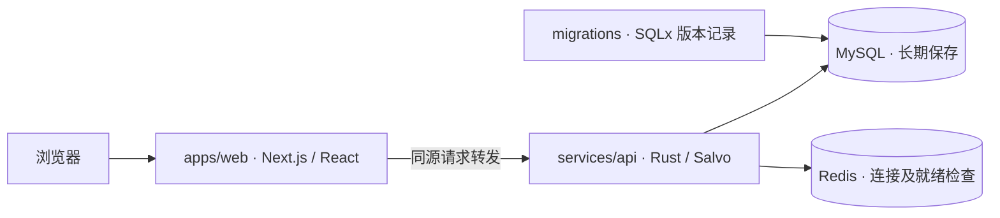

# 4.4 · 正式工程与最小读写流程

更新日期：2026 年 10 月 26 日。

本阶段建立自己的前端、后端和开发数据库，完成“网页输入 → 保存到 MySQL → 重新读取”。账户、论坛、商品和 AI 业务按后续阶段实现。

## 目录和连接关系



前端入口 `/`；联通检查 `/dev-check`。API 提供 `/health/live`、`/health/ready`、`GET /api/dev/records`、`POST /api/dev/records`。开发读写接口与未来 `/api/v1` 业务接口分开，测试记录不冒充帖子或用户。

## Windows：当前电脑怎样运行

先打开 Docker Desktop。项目现有 Node.js、Rust 和 MinGW 工具可继续使用；脚本会按实际目录寻找工具，不依赖原来的 E 盘。

在 PowerShell 中进入项目根目录，首次准备或依赖改变后执行：

```powershell
powershell.exe -NoProfile -ExecutionPolicy Bypass -File scripts/Prepare-Dev.ps1
```

启动网页和后端：

```powershell
powershell.exe -NoProfile -ExecutionPolicy Bypass -File scripts/Start-Dev.ps1
```

打开 <http://localhost:3000/dev-check>。填写内容，点击“保存记录”，再刷新页面确认仍可读取。默认前端使用开发模式，修改页面会自动更新；修改 Rust 后先停止并重新准备、启动。`Start-Dev.ps1 -Production` 使用已经构建好的 Next.js 页面。

停止程序和开发数据库，保留记录：

```powershell
powershell.exe -NoProfile -ExecutionPolicy Bypass -File scripts/Stop-Dev.ps1
```

先停止已打开的开发程序，再运行完整验证：

```powershell
powershell.exe -NoProfile -ExecutionPolicy Bypass -File scripts/Verify-Dev.ps1
```

Windows 验证默认使用已安装的 Edge；没有 Edge 时，在 `apps/web` 运行 `npx playwright install chromium`，并设置 `$env:PLAYWRIGHT_CHANNEL='bundled'`。完整验证会真实停止、重启开发数据库；不会连接检查库或云服务器，数据卷保留。

## 可选：其他开发环境准备

需要 Git、Node.js 24.14.0、Python 3、Rust 1.99.1 和 Docker Compose。Windows Rust 还需要本机链接工具：MSVC 配套 C++ Build Tools，或 GNU 配套 MinGW。已有项目内 GNU 工具时脚本会自动使用；不同 MinGW 位置可通过 `BYR_MINGW_BIN` 指定。

从你们自己的 `byr_program` 仓库拉取本次代码，不复制 `.local/`、`node_modules/`、`target/`、`.next/` 或别人的密码。Windows 按上一节执行。第一次下载依赖需要网络。

Linux / macOS / WSL 在项目根目录执行：

```bash
python3 scripts/dev.py init-env
python3 scripts/dev.py services
cargo build --locked -p youzhihui-api
python3 scripts/dev.py migrate
cd apps/web
npm ci --ignore-scripts --no-audit --no-fund
npx playwright install --with-deps chromium
cd ../..
python3 scripts/dev.py build-web
```

分别在两个终端运行 `python3 scripts/dev.py api`、`python3 scripts/dev.py web`。停止两个终端后，运行 `python3 scripts/verify_runtime.py` 验证；`python3 scripts/dev.py stop-services` 停止数据库并保留记录。Rust 工具由根目录 `rust-toolchain.toml` 固定，依赖由两个锁文件固定。

此步骤为选做，不作为本机4.4或4.5验收的前置。需要其他开发环境时记录：操作系统、工具版本、启动是否成功、保存刷新结果、重启后记录是否仍在。当前结果中的 `second_computer_tested` 仍为 `false`，该记录保留事实；最终主要验证服务器部署和浏览器网址访问。GitHub 自动检查也需要提交后实际运行，当前只配置了流程。

## 本机检查和结果

实际结果见 [runtime-verification.json](runtime-verification.json)：迁移重复执行、HTTP 保存读取、参数检查、Redis/MySQL 故障、浏览器交互和前后端/数据库重启读取。截图和细日志在 `.local/logs/dev/`。Rust 单元测试、Clippy 和前端构建单独执行。

CI 文件为 [engineering.yml](../../.github/workflows/engineering.yml)，提交到 main 或创建 PR 后，在独立 Ubuntu 环境执行构建和同一组检查。CI 会自行安装工具和浏览器，不依赖本机 `.local/`；报告、日志和截图作为检查附件保存。

## 配置与数据

`deploy/.env` 首次生成随机密码，已被忽略；`.env.example` 只含占位值。修改端口和前后端地址后重新准备并启动。网页及 API 默认只监听本机。开发读写接口默认关闭，开启时 API 必须监听回环地址，并检查浏览器 Origin。设置 `DEV_TOOLS_ENABLED=false` 后该接口返回 404。

开发库含 32 张业务设计表、1 张开发测试表；SQLx 另建迁移记录表。业务表存在不代表业务已实现。初始迁移保留原设计，后续通过新迁移修改；不要改写已执行文件。MySQL 数据卷与 `checks/` 分开，Redis 不承担测试记录的长期保存。

本阶段沿用既定技术栈和独立检查代码的已验证用法，没有直接复制三个参考仓库的业务源码；原始快照和许可证保持原样。页面字体沿用原本下载的 Noto Sans SC，OFL 许可随文件保留。

下一步为 **4.5：自主账号与身份限制**。需求依据 [T01](../../demand/T01_首版需求基线与验收清单.md)，设计依据 [4.3 设计包](../design/README.md)，返回 [项目首页](../../README.md)。

后续进度：4.5 账户与权限已在本机实现并通过验收，见 [账户说明](../accounts/README.md)。
