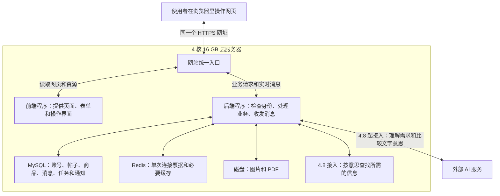
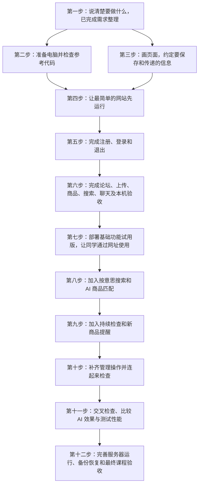

# 邮智汇三人项目计划书

更新日期：2026 年 10 月 28 日。

这份计划书说明我们要做一个什么网站、哪些现成代码能帮上忙、从现在到课程验收要经过哪些步骤，以及每一步要完成哪些任务、怎样检查已经完成。

当前本地工作目录：`D:\program_design_experiment`。迁移过程和验证结果见 [D 盘迁移记录](docs/migration-20261023.md)。

目前 4.1 需求统一、4.2 工具与参考代码检查及4.3页面数据设计已完成。准备结果见 [4.1 与 4.2 检查报告](demand/4.1与4.2_检查结果与使用说明.md)，设计结果见 [4.3设计包](docs/design/README.md)。4.4 正式工程及最小读写已在本机实现与验证，见 [工程说明](docs/engineering/README.md)；第二台电脑独立安装为选做，远端 CI 待上传后运行。4.5 自主账户与身份限制已在本机完成，见 [账户说明](docs/accounts/README.md)。4.6.1 论坛和通用上传已在本机完成并验证，见 [论坛说明](docs/forum/README.md)。4.6.2 商品和普通搜索也已完成本机验收，见 [商品说明](docs/goods/README.md)。4.6.3 聊天和通知也已完成本机实现与验收，见 [聊天说明](docs/chat/README.md)。4.6.4全流程验收也已完成，见 [整体验收](docs/acceptance/README.md)。原4.6.1—4.6.4四个业务板块已完成；**4.7基础功能试用部署也已完成**，网站为 <https://youzhihui.85-121-122-124.sslip.io>，操作见 [服务器使用说明](邮智汇_服务器使用说明.md)，检查结果见 [4.7记录](docs/deployment/README.md)。下一步进入4.8的AI搜索和商品匹配。

## 一、项目是什么，我们要完成什么

### 1. 我们要做的网站

项目名称暂定为“邮智汇”，是一个面向北邮师生的校园论坛。大家可以在这里讨论学习和生活、发布二手商品、联系卖家，也可以让 AI 帮忙查找信息、寻找合适商品，并在新商品出现时收到提醒。

我们希望解决的一个具体问题是：用户想找某样东西，却需要每天反复搜索、翻帖子、检查价格和地点。网站应该能理解用户说的话，把符合要求的信息找出来；暂时没有合适商品时，还能替用户继续留意。

### 2. 第一版必须完成的功能

| 功能 | 用户可以做什么 |
| --- | --- |
| 注册和登录 | 自己注册账号，登录、退出，修改昵称和头像；忘记密码时由管理员核实后帮助重置 |
| 论坛讨论 | 在学习、生活等板块发帖、评论、回复、点赞和收藏；查看置顶内容 |
| 二手商品 | 上传图片，填写价格、成色和交易地点，发布、修改商品，标记预留、已售或下架 |
| 站内私聊 | 两个人发送文字消息，查看历史和未读消息；断线或离线后仍能补看 |
| 全站搜索 | 搜索公开帖子和商品，既能按关键词找，也能按意思相近的表达找 |
| AI 商品匹配 | 输入一句需求，查看并修改 AI 理解出的条件，再看到合适商品及推荐理由 |
| 商品持续提醒 | 保存需求，让网站定期检查；出现符合条件的商品时收到站内通知 |
| 网站管理 | 管理员和版主按各自职责处理帖子、举报、违规商品、公告和被封禁账号 |

普通用户管理自己的内容；版主只管理分配给自己的板块；管理员负责全站管理。管理员也不能随意浏览所有人的私聊或私人需求。

### 3. AI 创新点要怎么体现

第一项是“按意思找内容”。例如用户搜索“适合初学者参加的编程比赛”，即使帖子没有完全相同的字，也应找到意思相关的内容。搜索范围只包括我们自己网站内允许公开查看的帖子和商品。

第二项是“理解买东西的要求”。例如用户输入“想收一台 2500 元以内、沙河校区交易的二手 iPad”，AI 应把商品种类、预算和地点整理出来，让用户确认或修改。之后先排除超预算、地点不符和非在售商品，再比较哪些商品更符合用途。推荐理由必须来自商品实际信息。

第三项是“替用户继续留意”。用户保存要求后，网站每隔一段时间检查新发布或有更新的商品，找到合适商品就保存通知。同一任务不能反复提醒同一商品，用户暂停或删除任务后也不能继续产生新提醒。

### 4. 这一版先不做什么

不接学校统一登录，不把自主注册账号标为已经通过学校身份认证，不收集学校门户密码。二手交易只负责发布信息和联系卖家，不做付款、担保或退款。

不做群聊、语音视频和聊天文件发送；不做 AI 校园问答、AI 发帖助手、伙伴推荐和科研招募等跨板块持续提醒。这些可以以后再加。也不抓取官方北邮人论坛的帖子和账号数据。

### 5. 最后应该演示出什么

准备买家、卖家以及管理账号，
现场完成：注册登录 → 发布并搜索帖子 → 发布商品 → 买家用一句话找商品 → 修改筛选条件 → 保存商品提醒 → 卖家再发布合适商品 → 买家收到通知 → 打开商品并联系卖家。

还要展示商品已售后不再被推荐、任务暂停后不再提醒、其他人不能修改自己的内容，以及网站重新启动后消息和任务仍在。

### 6. 三人要采用相同的使用规则

商品价格允许免费，最高为 99,999.99 元，最多保留两位小数。一个商品需要 1～6 张图片，过大、格式不对或超过数量的文件应明确拒绝。帖子、商品和聊天文字都要有长度限制，页面要告诉用户哪里不符合要求。

每人最多保留 10 个未删除的商品提醒任务，暂停或异常任务也计入；检查间隔最短为 5 分钟。AI 理解需求最多等待 15 秒，失败后让用户手动填写，不让用户一直等。已经保存的要求在日常检查时重复使用，不每次重新请 AI 理解一遍。

账号登录最长有效 7 天，退出后旧凭据立即失效；改密码或封禁后，其他已登录设备也不能继续使用。私聊、个人提醒要求和私人通知不能出现在全站搜索中。其他准确数值按文末链接中的详细要求执行。

## 二、项目复用的仓库介绍

三个仓库的原始代码都已保存在hub中的 `.upstream` 文件夹中，方便随时查看。下面的“预计复用”指准备采用或参考的内容，尚未全部搬到我们的网站中，也尚未全部验证能否运行。

### 1. hnu-doc

**原仓库地址：**[gygy-hh/hnu-doc](https://github.com/gygy-hh/hnu-doc)。

**原来的功能：**这是一个学校试卷和学习资料网站的服务器程序，负责登录、资料上传、资料查询、资料分类和审核。它使用 Rust，与我们准备采用的服务器程序语言一致。

**预计复用的内容：**优先检查它怎样启动、读取设置、记录运行情况、连接保存资料的地方，以及怎样统一返回成功或失败信息。图片和文件保存、列表分多页展示的写法也可以参考。

**我们仍要自己完成的部分：**它原来的登录依赖学校门户，不能直接用于本项目；我们要改成自主注册和登录。原来保存试卷的内容也不能直接当作帖子或商品使用。论坛、商品、聊天、AI 和持续提醒仍然需要按我们的需求编写。

这个仓库声明使用 MIT 许可，实际采用代码时应核对并保留作者要求的说明。是否采用某个部分，要以实际阅读和运行检查结果为准。

### 2. jhserver

**原仓库地址：**[gygy-hh/jhserver](https://github.com/gygy-hh/jhserver)。

**原来的功能：**这是一个游戏服务器，包含游戏邮件、定时发送、账号登录状态和管理页面等功能。

**预计复用的内容：**主要参考“怎样在指定时间执行一件事”“怎样给指定用户发送通知”“怎样让旧登录凭据失效”等做法，再用我们自己的 Rust 程序实现。

**我们仍要自己完成的部分：**游戏邮件不是论坛私聊，定时发一封邮件也不等于持续检查商品。我们要补上定期检查、保存用户要求、避免重复提醒、暂停任务、失败后再试和重启后继续运行等功能。

不需要把整套游戏服务器接进来，也不需要为了商品提醒再运行一套 C++ 服务。本地版本包含 MIT 许可文件，使用代码时保留相应说明。

### 3. FRAS-lab-website

**原仓库地址：**[gygy-hh/FRAS-lab-website](https://github.com/gygy-hh/FRAS-lab-website)。

**原来的功能：**这是一个实验室官网。访客可以看实验室介绍、成员、成果、新闻和活动；管理员可以登录后台，添加或修改这些内容，也可以上传图片和文件。

**预计复用的内容：**主要参考导航、卡片、列表、编辑表单、上传操作、成功失败提示，以及管理员如何维护内容。它逐步调整资料保存方式的做法，也值得参考。

**我们仍要自己完成的部分：**原网站主要面向管理员维护实验室资料，没有我们的普通用户讨论、二手交易、私聊和 AI 功能。它的页面用 Vue、服务器程序用 Java，与我们选用的 React、Rust 不同，所以主要借鉴做法，再按我们的选择重写。还要补上不同角色的管理范围、文件检查以及退出登录后旧凭据失效等规则。

所查版本未发现许可文件，直接复制代码前要确认作者允许的范围；没有确认时先参考设计、自行编写。原站的图片、账号、密钥和部署脚本不直接用于本项目。

### 4. 三个仓库分别帮我们什么

| 仓库 | 主要帮忙的地方 | 主要阅读人 |
| --- | --- | --- |
| hnu-doc | 网站背后的处理程序、保存资料和通用处理方式 | A 主读，C 检查运行条件 |
| jhserver | 到点执行任务、通知和失败处理的思路 | C 主读，B 一起确认商品匹配如何接入 |
| FRAS-lab-website | 网页样式、管理页面、编辑和上传体验 | B 主读，A 一起确认管理操作 |

我们的目标是从三个仓库中挑出合适的部分，最后做成一个网站。并不是把三个完整网站同时装到服务器上。

## 三、从零到项目验收，全流程介绍

### 1. 网站怎么运转（架构图）

这里先区分两个名字：**前端**是用户在浏览器里看到和操作的页面；**后端**是在服务器上接收操作、检查身份、保存资料、调用 AI 和发送消息的程序。管理员看到的管理页面也属于前端，不能把“管理后台页面”和“后端程序”混为一谈。

使用者操作前端网页，网页把要求交给后端程序。后端检查用户能不能操作，读取或保存资料，需要时再请 AI 帮忙理解文字。聊天和提醒也由后端处理，再把结果显示到前端。

前端准备使用 Next.js 和 React 编写；后端使用 Rust、Salvo 和 Tokio。长期资料用 MySQL 保存，临时信息用 Redis 保存，图片和文件先放在服务器磁盘上。“按意思查找内容”具体采用哪一种工具，还需要通过试验决定。

这些名字是所用工具的名称。对分工来说，关键是知道：前端负责展示和操作，后端负责判断与处理。网页不能直接修改长期保存的资料，也不能直接拿着 AI 密钥调用服务；这些操作经过后端。AI 不会得到用户密码、私聊或私人附件。

先把基础功能部署到已有的4核、16 GB服务器，地址为`85.121.122.124`。4.7已检查系统、可用磁盘和已有服务，访问地址为 <https://youzhihui.85-121-122-124.sslip.io>；外网可达性已验证，带宽峰值未做专项测速。访客只需浏览器，不安装开发工具；网站由服务器运行，不依赖开发电脑一直开机。现已核对Ubuntu 24.04和已有服务，独立部署基础功能；尚未进行规定的多人负载测试。AI以后优先调用外部服务。

### 2. 从准备到验收的路线

第二步和第三步可以同时开展；第六步的四个业务板块按“论坛和通用上传 → 商品和普通搜索 → 聊天和通知 → 全流程验收与修复”推进，现已完成本机验收。4.7试用部署也已完成，接着继续4.8—4.11；每项新功能先在开发和独立测试环境检查，通过后再更新试用站。4.12保留最终课程验收，不再等到这一步才首次部署。例如，提醒必须使用已经能工作的商品匹配方法，不能先做一套与搜索无关的假提醒。

管理方面的限制要随每个功能一起做。第十步是补齐管理页面和检查遗漏，不能等到最后才判断谁可以修改谁的资料。

### 3. 做到什么样才算完成

每一步都要留下能展示的结果。一个按钮点下去，必须真的保存成功，刷新网页还能看到；别人无权操作时，网页和服务器都应拒绝；失败时要说明情况，不能假装成功。

整个网站完成后，还要能由另一位成员按照说明重新运行，重新启动后重要资料仍在，并能从事先保存的副本中恢复一次。需求文档、参考代码或一张漂亮的页面，都不能代替这些检查。

## 四、每个流程需要完成哪些任务

下面只说明任务，不安排人员。每一步都写清楚要做的内容、前端和后端分别需要处理什么，以及怎样判断已经完成。前端是网页上的展示与操作，后端是实际检查、处理和保存信息的程序。

### 子目录表

| 编号 | 子目录 | 这一项要得到什么结果 |
| --- | --- | --- |
| 4.1 | 明确第一版要做的内容 | 一份一致的功能、使用规则和检查清单；这部分需求整理已完成 |
| 4.2 | 准备运行工具，检查参考代码 | 已完成本机最小验证，工具和复用结论见检查报告 |
| 4.3 已完成 | 画页面，约定要保存和传递的信息 | 已交付页面、数据、接口、实时事件、权限状态和共用匹配规则，见设计包 |
| 4.4 | 让最简单的网站先运行 | 网页能向后端发送操作，后端能保存资料并返回结果 |
| 4.5 | 完成账户和身份限制 | 注册、登录、退出、个人资料和不同角色都能实际使用 |
| 4.6 | 完成论坛、商品和聊天 | 按下列四个板块实现并验收，从发帖、商品搜索连到卖家私聊 |
| 4.6.1 | 论坛和通用上传 | 已完成本机实现与验收，论坛互动及共用文件上传可用 |
| 4.6.2 | 商品和普通搜索 | 已完成本机实现与验收，商品发布管理、关键词搜索及筛选可用 |
| 4.6.3 | 聊天和通知 | 已完成本机实现与验收，联系卖家、实时私聊、未读和通知通道可用 |
| 4.6.4 | 全流程验收与修复 | 已完成本机验收，8组跨模块检查与3个浏览器测试通过 |
| 4.7 | 基础功能试用部署 | 已完成：HTTPS试用站、来源限流、持久数据、更新备份与外网检查 |
| 4.8 | 完成按意思搜索和 AI 商品匹配 | 用户能用一句话查找内容、修改条件并得到合适结果 |
| 4.9 | 完成持续检查和商品提醒 | 需求保存后会定期检查，通知不重复，暂停和恢复有效 |
| 4.10 | 完成管理页面，检查功能之间的联系 | 举报、隐藏、下架、封禁和公告能产生正确结果 |
| 4.11 | 检查整个网站，比较 AI 效果 | 功能、权限、故障和等待时间有记录，AI 比较有真实结果 |
| 4.12 | 完善服务器运行，准备最终课程验收 | 试用站包含完整功能，独立恢复验证通过，完整演示和说明材料齐备 |

4.2和4.3可以同时开展；原4.6的四个业务板块沿用前面完成的功能。4.7紧接4.6.4执行，先提供基础功能试用站；4.8—4.10完成后逐步更新该站点。4.9仍要使用4.8已经能工作的匹配方法，试用部署不改变AI必做范围。每做完一小部分就接起来检查，不等最后再把所有功能放到一起。

### 4.1 明确第一版要做的内容

**要做什么：**固定本次必须完成的功能、暂时不做的功能、用户可以操作的范围，以及文件大小、商品价格、提醒周期等使用限制。

需要把以下问题说清楚：

- 第一版包含账户、论坛、商品、文字私聊、通知、全站搜索、AI 商品匹配、商品提醒和管理功能。
- 普通用户只能管理自己的内容，版主只能处理指定板块，管理员也不能随意浏览所有人的私聊和私人需求。
- 不接学校统一登录，不做支付、群聊、音视频及已经确定留到以后的 AI 功能。
- 每个功能都要说明正常操作的结果、非法操作怎样拒绝、出错时显示什么，以及重新启动后哪些资料必须保留。

**完成标准：**所有相关说明采用同一套规则，不能一处写“AI 搜索必须完成”，另一处又写“有时间再做”。这项需求整理已通过 T01 完成；原 Word 保留不改，当前开发按已统一的 Markdown 要求执行。后续增加功能或调整数值时，同时更新相应说明。

### 4.2 准备运行工具，检查参考代码

**要做什么：**确认电脑能够制作和运行网页、后端程序及保存资料所需的工具，并检查参考代码是否真的适合采用。

具体完成以下工作：

1. 检查 Node.js、Rust、Docker、MySQL 和 Redis 等工具的可用情况，记下版本、启动方法及缺失项。
2. 尝试编译 `hnu-doc`，检查启动、设置读取、运行记录和资料连接等通用部分；不实际调用学校登录，也不运行需要个人门户凭据的检查。
3. 阅读 `jhserver` 的定时执行与通知做法，以及第三个仓库的页面、表单、上传和内容管理做法，说明准备借鉴什么。
4. 检查作者允许怎样使用代码，保留应当保留的说明。示例账号、密码、密钥及原站部署脚本不直接使用。
5. 如果整套参考程序无法运行，记录原因，改为单独验证准备采用的部分。

**完成标准：**按照记录能够重复运行必要的最小示例；每个准备采用的部分都有明确结论。只下载了代码或看到了文件，不代表检查完成，也不要求同时运行三个完整参考项目。

**本次结果（2026 年 10 月 20 日）：已完成。**Node.js、项目内 Rust、Docker、MySQL 和 Redis 可用；Next.js 示例和第三个仓库前端构建、访问检查通过，`hnu-doc` 按原锁文件检查及一项纯计算测试通过。独立 Rust 示例完成配置读取、Salvo 内部请求、数据库和缓存读写，重启检查容器后仍能读回数据。运行步骤见 [checks 说明](archive/preparation-checks/README.md)，逐项结果与复用取舍见 [检查报告](demand/4.1与4.2_检查结果与使用说明.md)。这些结果不代表 4.4 的正式前后端已接通，也不代表账户、AI 或其他业务已完成。

### 4.3 画页面，约定要保存和传递的信息

**当前进展（2026 年 10 月 23 日）：已完成设计交付。**保留 [HTML 页面草图入口](archive/early-docs/page-drafts/index.html)，补齐 [4.3设计包](docs/design/README.md)：页面操作清单、32张表及字段关系、89项HTTP操作、13类实时帧、权限状态及搜索/提醒共同匹配规则。契约格式、字段样例及独立MySQL空库约束检查通过，详见 [完成核对](docs/design/05_完成核对.md)。这不代表正式业务或实际浏览器视觉兼容性已验收。

#### 前端要准备什么

画出首页、板块和帖子、注册登录、商品列表和详情、AI 搜索、聊天、通知、提醒任务及管理页面。标明主要按钮、填写项和页面之间的跳转。

每个页面都考虑正在加载、没有内容、填写错误、没有权限及操作失败时的样子。先让页面信息和操作清楚，再统一导航、颜色、卡片和表单。

#### 后端要准备什么

列出需要长期保存的信息，例如用户与角色、板块帖子评论、商品图片状态、会话消息、个人通知、提醒条件、每次执行结果及管理记录。说明这些信息之间怎样对应，例如商品属于哪个卖家，消息属于哪个会话，通知发给哪个用户。

对每次操作写明：前端提交什么，后端检查什么，成功返回什么，失败怎样说明。统一编号、时间、每页数量及商品状态等写法。例如，“发布商品”需要提交标题、价格、地点和图片，保存成功后返回商品编号及详情。

**完成标准：**有主要页面草图和操作信息清单，制作前后端时不需要反复猜测。搜索和提醒共用的商品匹配输入、输出也已约定好。

### 4.4 让最简单的网站先运行

**2026 年 10 月 26 日进度：本机实现与验证完成。**已建立正式前后端、开发数据库、迁移、启动脚本和 CI 文件；浏览器保存刷新、数据库故障及全部重启后读取通过。第二台电脑独立安装为选做，远端 CI 待上传后运行，步骤见 [4.4 工程说明](docs/engineering/README.md)。

#### 前端要做什么

建立能打开的网页，准备共用导航、表单、列表和提示写法。先制作一个测试页面，能够发送一条简单操作，并显示后端返回的结果。

#### 后端要做什么

建立能够启动的程序，读取运行设置，连接资料保存工具，记录错误并返回清楚的成功或失败信息。准备创建资料保存位置的方法，以及一起启动所需程序的说明。

#### 怎么检查

从网页填写一条测试内容，交给后端保存，再重新读取并显示。刷新网页、重新启动程序后，仍能读到这条记录。本阶段以本机验收为准；其他开发电脑独立安装选做，服务器试部署时验证新环境运行与网址访问。

**完成标准：**前端、后端和资料保存已经真正连上，启动方法可以复现。

### 4.5 完成账户和身份限制

**4.5 本机验收完成**（2026年10月26日）。真实接口、浏览器、头像归属、改密/重置/封禁撤销会话、并发管理员保护及故障/重启已验证，见 [账户说明](docs/accounts/README.md)。AC02 的实时连接5秒失效项在4.6补验。

#### 前端要做什么

完成注册、登录、退出、昵称头像修改和个人资料页面，显示登录过期、账号被封禁、重复注册及填写错误等提示。页面按用户身份显示可以使用的操作。

#### 后端要做什么

检查账号格式及是否重复，用专用方式保存密码，处理登录有效期、退出、改密码和封禁。注册只能得到普通用户身份，管理身份不能由注册者自己选择。

完成管理员帮助重置密码的流程。无论按钮是否显示，后端收到操作时都要重新检查身份和允许范围；退出后旧凭据不可继续使用，改密码或封禁后其他旧会话也应失效。

#### 怎么检查

用普通用户、版主和管理员分别登录，检查允许和禁止的操作。尝试重复账号、非法密码、连续登录失败、退出后继续请求、使用重置凭据，以及重启后重新登录。

**完成标准：**各身份的限制真实有效，密码不能直接读回原文，退出不是只让页面看起来已经退出。

### 4.6 完成论坛、商品和聊天

原4.6.1—4.6.4四个业务板块已接入真实后端并完成本机验收，完成记录保持原样。4.7基础功能试用部署为独立阶段，已完成服务器运行与外网检查。AI搜索、商品智能匹配和持续提醒仍分别在4.8、4.9实现，试用站不提前宣称这些能力可用。

| 编号 | 板块 | 主要结果 |
| --- | --- | --- |
| 4.6.1 | 论坛和通用上传 | 已完成：真实发帖互动及共用上传；商品绑定在下一板块实现 |
| 4.6.2 | 商品和普通搜索 | 已完成：真实商品发布管理、图片绑定、关键词搜索与筛选 |
| 4.6.3 | 聊天和通知 | 已完成：联系卖家、实时文字聊天、历史未读和个人通知通道 |
| 4.6.4 | 全流程验收与修复 | 已完成：同批数据联通、权限与管理联动、故障重启及回归 |

#### 4.6.1 论坛和通用上传

**本机实现与验收完成（2026 年 10 月 26 日）。**论坛、帖子管理和各用途上传已接入真实后端；19 组运行检查、3 个浏览器测试及原有账户/工程回归通过，见 [使用与检查说明](docs/forum/README.md)。商品图片的业务绑定在 4.6.2 完成。

**前端任务：**完成板块列表、帖子列表和详情、发帖编辑、评论回复、点赞收藏、我的帖子和我的收藏；显示置顶状态。准备共用的文件选择、上传进度、预览、移除和错误提示，供头像、帖子及商品页面使用。

**后端任务：**整理已有的登录、身份和请求保护方法，供各业务共用；保存板块、帖子、评论、点赞和收藏。检查作者和版主管理范围，完成置顶、隐藏、恢复及删除所需的操作并记录原因。重复点赞收藏不能增加重复记录，父评论必须属于同一帖子，正文不能执行用户输入的 HTML 或脚本。

扩展现有头像上传，支持帖子图片、帖子 PDF 和商品图片。按用途检查真实类型、文件大小、数量、归属和用户剩余空间；上传后暂存，内容保存成功后再绑定。发布失败可重试，未使用文件按规则清理；内容隐藏或删除后，附件直链也不能继续公开访问。具体限制沿用 T01，不另设一套数值。

**完成标准：**至少两个板块可以发帖、浏览、回复和点赞收藏，刷新后仍在；他人内容不能编辑，版主不能跨板块管理。通用上传已支持各用途，帖子附件可绑定读取；非法文件、越权绑定和超配额上传被拒绝，已有头像功能继续正常。

#### 4.6.2 商品和普通搜索

**本机实现与验收完成（2026 年 10 月 28 日）。**商品、图片绑定、价格与状态、管理员限制及统一关键词搜索已接入；17 组运行检查、4 个浏览器测试和原有功能回归通过，见 [商品与搜索说明](docs/goods/README.md)。聊天和通知在下一板块实现，AI 搜索在 4.8 接入。

**前端任务：**完成商品列表和详情、发布编辑、我的商品、图片选择与排序，以及预留、已售、下架和允许情况下的重新上架。完成普通搜索页，能区分帖子和商品，按类别、价格、校区等条件筛选；翻页或返回列表时保留条件。

**后端任务：**使用通用上传保存商品图片，检查卖家归属、商品字段和版本。金额按整数分保存，支持免费商品，拒绝超过两位小数及超范围价格；商品状态按 T01 流转，已售不能恢复在售，管理员限制不能由卖家绕过。

实现公开帖子与商品的关键词搜索、筛选和稳定分页。普通商品检索默认在售，主动指定时可查看其他公开状态；隐藏、删除或被治理限制的内容不能公开返回。内容变更时保存后续搜索更新所需的变更记录，为 4.8、4.9 留下可共用的数据依据。

**完成标准：**能发布一件带图商品、修改价格、按关键词和条件找到、查看详情并标记已售。价格和状态边界正确，其他人不能修改卖家的商品；隐藏或删除的内容及附件不可从搜索或旧地址读出。

#### 4.6.3 聊天和通知

**本机实现与验收完成（2026 年 10 月 28 日）。**14 组运行检查、4 个浏览器测试通过，包含真实网页转发、消息去重补读、通知当前权限、推送失败及重启；退出、到期、改密、重置和封禁的旧连接均在 5 秒内关闭。见 [聊天与通知说明](docs/chat/README.md)。匹配提醒和举报通知的产生仍随 4.9、4.10 接入。

**前端任务：**完成“联系卖家”、会话列表、聊天窗口、发送状态、历史消息和未读数量；完成个人通知列表、未读展示、单条及全部标记已读。聊天与通知分开显示，断线时提示，恢复后补读遗漏内容。

**后端任务：**先完成普通请求下的消息保存、历史读取和已读位置，再接入 WebSocket 实时连接。从商品确定卖家，重复联系复用双方会话，不能联系自己。消息必须保存成功后才确认；相同发送标识重试不重复保存，离线记录保留，会话历史只允许双方读取，管理员身份也不能绕过。

实时连接使用已有设计的一次性票据，验证来源与登录状态，并实际检查前端转发和启动配置。实时推送失败不丢弃已保存内容，连接不可用时仍允许普通请求发送和补读。退出、到期、改密、重置或封禁后，相关旧连接最迟 5 秒内关闭，失效连接不能继续处理业务。

完成通知保存、读取、已读与实时推送的共用方法；只返回本人的通知，目标隐藏或删除后不泄漏旧内容。商品匹配和举报结果通知分别随 4.9、4.10 接入，本阶段使用独立测试通知检查通道。

**完成标准：**两个浏览器账号可从商品页进入正确会话并聊天；重试、离线、断线和重启后消息完整且不重复。第三个账号不能读取或接收会话内容，个人通知与已读结果可持久保存，旧实时连接 5 秒失效检查通过。

#### 4.6.4 全流程验收与修复

**本机验收完成（2026年10月28日）。**新增8组跨模块检查、3个真实浏览器测试，工程/账户/论坛/商品/聊天回归全部通过；原三个账号用户记录前后相同。通知内部状态已改为中文。结果见 [整体验收](docs/acceptance/README.md)，实际覆盖范围见 [范围表](docs/acceptance/验收范围.md)。4.6不包含后续AI、监控、完整性能和服务器验收。

**前端任务：**逐页检查正常、加载、空内容、填写错误、无权限和保存失败的显示；检查导航、返回列表、筛选保留、窄屏及刷新后的结果。完整操作“登录 → 发帖回复 → 发布商品 → 搜索商品 → 联系卖家 → 聊天 → 查看通知”，不把页面出现内容当作已保存成功。

**后端任务：**使用独立测试数据库和测试账号，检查归属、版面授权、重复点赞收藏、重复发送、同时编辑、文件权限、数据库故障、实时断线和重启恢复。回归 4.5 账户功能，确保改密和封禁对新业务同步生效；不更改现有开发库中的三个指定账号。

**修复与记录：**发现问题后修复并重跑对应检查；保存实际结果，更新 README、成果汇报及运行说明。逐项注明已验收、部分验收或待后续验证，不把关键词搜索当作 AI 搜索通过，也不把本阶段检查当作 4.11 的完整性能与 AI 评测。

**完成标准：**论坛、商品、搜索、聊天和通知按上述范围联通，已确认保存的内容在刷新或重启后仍可读取；越权被拒绝，故障不显示虚假成功，影响本阶段完成的问题已修复并复验。本机业务验收完成后先进入4.7试用部署，再继续4.8的AI开发。

### 4.7 基础功能试用部署（已完成）

**完成结果（2026-10-29）：**已部署到 <https://youzhihui.85-121-122-124.sslip.io>。正式容器、HTTPS、可信来源登录限流、开发入口关闭、专用管理员和独立数据卷已配置；公网双会话基础流程、权限、改密失效、更新与项目容器重启、备份校验和临时库关键恢复检查通过。每日备份启用，一份异地副本已下载到本机。共享宿主机未重启，实际手机、正式负载、自动异地同步与完整独立环境恢复不在本次完成记录内。见 [使用说明](邮智汇_服务器使用说明.md) 与 [验证结果](docs/deployment/verification.json)。

**要做什么：**先把现有基础功能部署到服务器，让少量同学直接通过网址注册登录、发帖回复、发布搜索商品和私聊。网站不依赖开发电脑一直开机，更新和重启后资料仍在。AI、举报公告及部分通知来源按后续阶段接入，不提前宣称可用。

#### 前端要做什么

检查HTTPS网址下的导航、登录、图片/PDF上传查看和实时聊天，不残留`localhost`请求；关闭开发检查入口，清楚显示尚未开放的功能。

#### 后端和服务器要做什么

核对`85.121.122.124`的系统、磁盘、内存、带宽及已有服务，确定访问地址和HTTPS配置。为前端、Rust后端、MySQL和Redis准备独立的正式运行设置，优先用Docker Compose统一启动；先只运行一个后端进程，数据库和Redis仅供内部访问。补齐开机启动、异常恢复、日志、更新和停止方法，不照搬Windows程序、本机缓存和依赖目录。

修正转发后的真实访客IP识别，避免一个人输错密码连带限制其他人；只信任受控网站入口的来源信息。配置HTTPS来源、安全Cookie、上传限制和WebSocket转发，关闭开发读写接口（`DEV_TOOLS_ENABLED=false`），生成并保存服务器专用密钥，设置独立管理凭据，不沿用公开测试密码。

确定使用新数据库还是迁移本机资料；迁移前备份数据库和上传文件，保留本机副本及三个账号。正式数据和图片使用持久保存位置，更新前保留可恢复副本及上一版代码，检查关键内容可恢复；完整独立恢复演练留到4.12。服务器登录信息和密钥单独保存，不写进代码仓库。

#### 怎么检查

至少用两个独立浏览器会话，并包含一台通过外网访问的其他设备，完成“注册登录→带图发帖回复→发布商品→关键词搜索→联系卖家→实时聊天”。检查刷新、断线补读、退出改密、权限、管理隐藏/下架和旧文件访问；已有通知时检查已读，没有通知时检查空状态。

验证登录限流仍有效，独立访客不会被误连带限制，伪造转发头也不能绕过限制。关闭本机开发程序后网站仍可用，重启服务器程序后数据和图片仍在。开发、自动验收与试用站使用各自的资料位置，不在试用库上直接运行停库或故障测试。

通过后邀请少量同学试用，记录实际网址、运行方法、反馈及修复结果。后续功能先在开发和独立测试环境检查，再更新试用站，保护试用期间新产生的资料。

**完成标准：**其他人通过HTTPS网址可使用基础流程；登录来源、权限、上传和实时聊天检查通过；开发电脑关闭、服务器重启或更新后仍正常使用且不丢资料。部署和备份步骤有记录，影响试用的问题已修复；之后继续4.8的AI开发，规定负载测试和最终交付仍在4.11、4.12完成。

### 4.8 完成按意思搜索和 AI 商品匹配

本阶段先搭建 [共用AI调用接口](docs/design/07_共用AI调用接口.md)，让商品需求理解、举报分析和后续功能共用连接、密钥、限制和错误处理；文本生成与向量接口分开适配。新增功能登记自己的输入、提示词和输出规则，浏览器不直接调用通用模型代理。

将 [帖子举报与AI辅助处理](docs/design/06_帖子举报与AI辅助处理.md)从4.10提前并行完成：先接通用户举报、管理员提醒、人工裁定和结果通知，再接入文字AI建议。AI失败不阻断人工处理，最终决定由有权管理员或授权版主作出。举报不替代本节原有搜索与商品匹配必做内容；目前均为待实现任务。

#### 前端要做什么

完成自然语言输入、AI 理解出的条件、条件修改、搜索结果和推荐理由展示。明确区分正在等待、没有合适结果、AI 失败及已经改用普通筛选等情况。

例如输入“2500 元以内、沙河交易的二手 iPad”，页面应展示预算、地点和商品类型，让用户确认或修改，再查看结果。

#### 后端要做什么

接入用于理解文字的 AI 服务，让公开帖子和商品可以按意思查询。商品匹配先排除超预算、地点不符、非在售及其他不满足明确要求的商品，再比较哪些更相关。

推荐理由只能来自商品实际信息。新增或修改内容后更新搜索所需的信息；隐藏、删除或无权查看的内容，返回结果前必须排除。整理出同一套商品匹配方法，供搜索和持续提醒共用。

AI 理解需求最多等待 15 秒，失败后允许用户手动填写条件；普通搜索仍可使用，密钥不放到网页中。

**完成标准：**普通关键词和同义表达都能查到相关内容；用户修改预算、地点后结果相应改变；超预算、已预留、已售或下架商品不会成为有效匹配。

### 4.9 完成持续检查和商品提醒

#### 前端要做什么

完成保存需求、任务列表、条件查看编辑、周期设置、暂停、恢复、删除和异常提示。展示最近检查时间、下次检查时间及通知入口。

#### 后端要做什么

用户确认后保存要求，定期使用已保存条件检查商品，不每次重新请 AI 理解需求。首次检查可以寻找当前在售商品，后续主要检查新增或更新内容。

找到合适商品后先保存通知，再提示在线用户；离线用户以后仍能查看。同一任务不能反复提醒同一商品，修改商品或任务条件后也保留已有提醒记录。

处理检查失败、超时和重新启动：失败按已定次数等待后重试，持续失败显示异常；程序重新启动后恢复有效任务。检查开始前和通知保存前，都确认账号未被封禁、任务仍启用、商品仍在售。

**完成标准：**发布一件符合要求的新商品后收到一次提醒；重复检查不重复通知；暂停、删除、商品已售和账号封禁后不产生新的无效提醒；重新启动后仍能继续检查。

### 4.10 完成管理页面，检查功能之间的联系

帖子举报及其AI辅助已提前安排到4.8，完成情况以实际验收为准。本节继续补齐评论、商品、私信举报，公告及完整管理联动，复用已建举报处理流程；私信不送入本次共用AI外部分析。

#### 前端要做什么

完成用户、角色、板块、帖子、商品、举报、公告和提醒任务的管理页面。管理按钮只在允许使用时出现，处理后显示明确结果。

举报人能看到自己举报的处理结果；草稿公告不公开，发布后才出现在网站上。

#### 后端要做什么

实现封禁、授权、置顶隐藏、违规商品下架、举报处理、公告发布撤回及异常任务暂停。记录谁在什么时间、因为什么，对哪个对象做了什么处理，以及处理结果。

检查每次处理对其他功能的影响：隐藏帖子后不能再被搜出；商品下架后不能继续产生新提醒；封禁后旧登录、聊天和任务都要受到限制。管理员不能默认阅读所有私聊或私人条件，消息举报只展示被举报内容及必要上下文。

**完成标准：**每个管理动作在其他页面也真实生效，没有“管理页说已下架，搜索和提醒里仍然有效”的情况。

### 4.11 检查整个网站，比较 AI 效果

#### 4.11.1 检查日常功能和出错情况

在独立测试环境按已有20项检查逐项操作，记录操作内容、预期结果、实际结果及是否通过；测试资料与试用用户的真实资料分开，不在试用库上直接进行清理或故障注入。覆盖正常使用、错误输入、重复提交、越权、断线、AI 不可用、保存失败和重新启动。

前端检查页面显示、按钮、表单及失败提示；后端检查真实保存、身份限制、重复消息和通知、恢复后的资料。发现问题后修改，并重新执行原来失败的检查。

#### 4.11.2 比较普通搜索与 AI 搜索

准备 500 件模拟或经允许使用的商品和 40 条需求，其中至少 20 条使用同义表达或用途描述。由两位成员共同确认哪些商品应被找到，解决分歧后固定题目和答案，再分别运行普通搜索及 AI 搜索。

记录相关商品找到了多少、前面的结果是否合适、条件理解是否正确、预算地点有无违反，以及提醒的正确和遗漏情况。不能测试后只挑表现好的题目。

目标为：条件理解及提醒准确率达到已定的 90%，预算地点等明确条件的违规数为 0；整体排序不差于普通搜索，同义表达题目找得更全。提醒另测至少 20 次应提醒和 20 次不应提醒场景，重复通知数为 0。

#### 4.11.3 检查同时使用时的等待时间

准备 50 个账号、1,000 条帖子、3,000 条评论、500 件商品、2,000 条消息和 100 个任务。让 20 个普通请求、10 条聊天连接及提醒任务共同运行至少 5 分钟，记录实际等待时间和出错情况。

至少 95% 的浏览列表、查看详情、发帖和评论在 1 秒内完成；关键词搜索在 2 秒内、按意思搜索在 3 秒内、已连接双方消息在 2 秒内完成，也分别按至少 95% 检查。外部 AI 理解需求及大文件上传单独记录；正常商品提醒目标为不晚于检查间隔再加 2 分钟，同样按至少 95% 检查。

**完成标准：**每项都有真实结果，未通过的问题已修复或明确记录。所有数值是需要验证的目标，不写成已经达到的事实。

### 4.12 完善服务器运行，准备最终课程验收

4.7已提前安排基础功能试用部署。本阶段在该站点上完成全部成果的最终核验，不重复安排第一次上线；即使试用站已可访问，仍需完成本节内容。

#### 检查完整功能和运行结果

把4.8—4.10完成的AI搜索、商品匹配、监控提醒、举报公告等更新到服务器，通过最终网址验证完整流程。结合4.11的性能和AI评测结果处理剩余问题，记录网站使用方法、更新停止方法和常见问题。确认另一位成员能按说明运行维护。

#### 完成独立备份恢复演练

备份账号、帖子、商品、消息、任务、通知及图片文件，在与试用库分开的环境完整恢复一次。核对资料和文件访问，恢复后提醒任务继续运行，消息与通知不重复。保留实际恢复步骤和检查结果，不能仅以“已经生成备份文件”作为通过依据。

#### 准备最终演示和材料

准备源码、运行说明、实际检查记录、AI比较结果和演示账号。完整演示“注册登录→发帖搜索→商品发布→AI匹配→保存监控→新商品提醒→卖家私聊”，补充越权拒绝、商品已售、任务暂停和重启恢复的结果。密钥及服务器登录信息仍单独保存。

**完成标准：**最终网址包含约定的完整功能；规定的功能、AI效果和性能检查有真实结论；独立恢复成功；课程演示和交付材料齐备。试用部署成功不能替代最终验收。

详细规则、准确文件大小和完整检查条件见 [第一版需求与检查清单](demand/T01_首版需求基线与验收清单.md)。三个参考仓库的本地位置见 [参考源码目录说明](.upstream/README.md)。需要核对细节时查看这些文件，具体开发按本节任务顺序推进。
